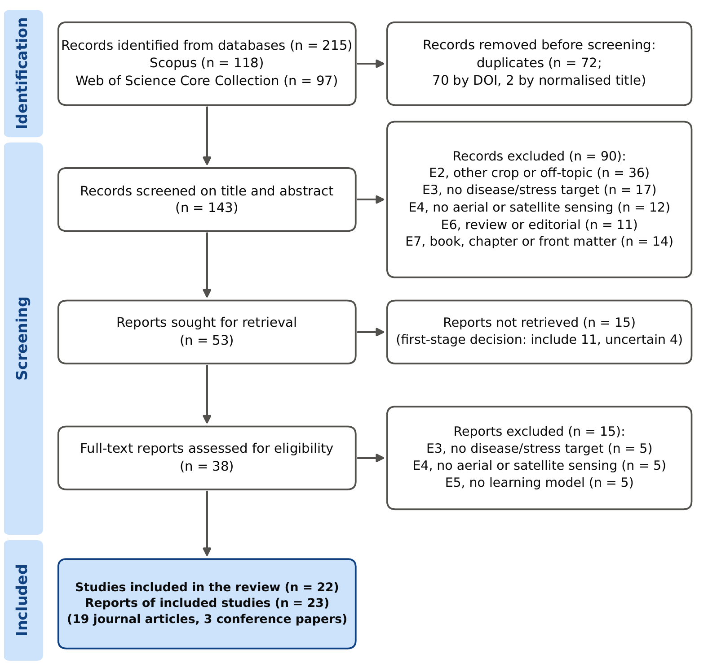
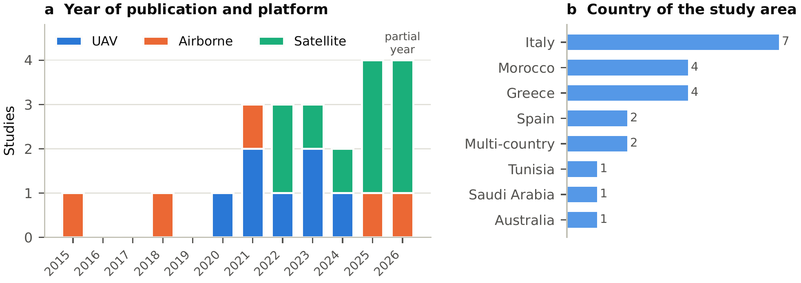
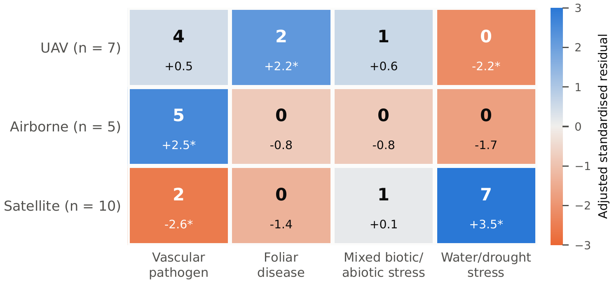
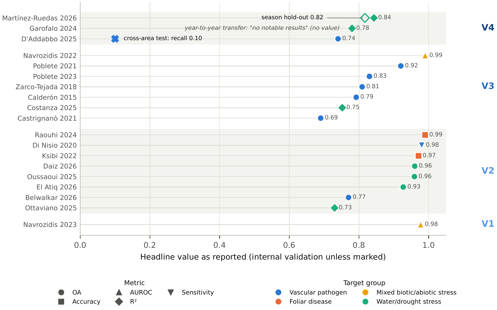
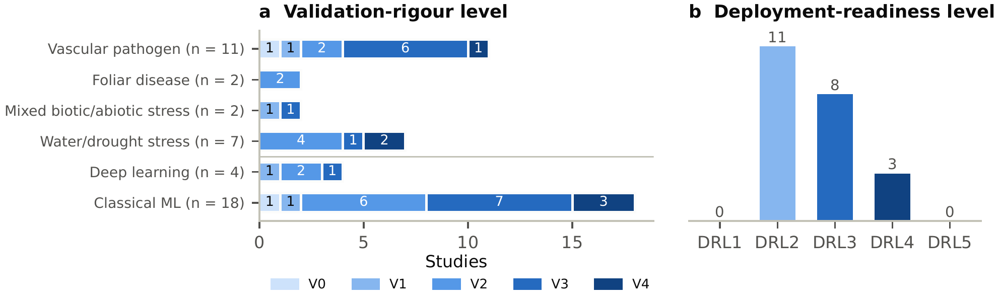
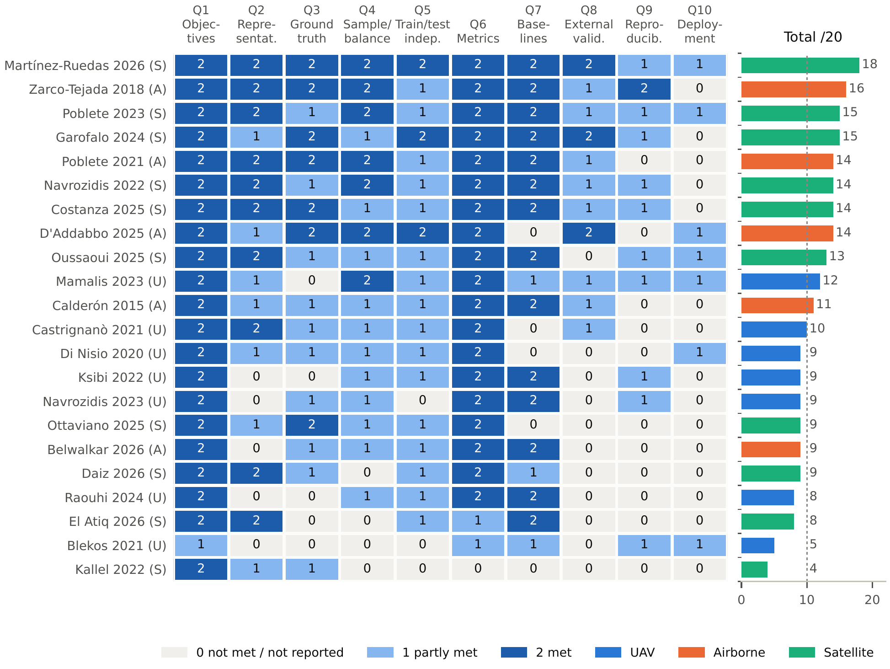

> Markdown copy generated from `systematic_review_prisma2020.tex` by `scripts/tex_to_markdown.py`. The LaTeX/PDF version is the reference (numbered citations, journal layout).

# Machine learning and remote sensing for disease and stress detection in olive (*Olea europaea* L.): a systematic review of platforms, targets, algorithms and validation practice

**Abstract.** Olive (*Olea europaea* L.) is threatened by *Xylella fastidiosa*, *Verticillium dahliae*, foliar diseases and drought, and machine learning (ML) applied to images from unmanned aerial vehicles (UAV), aircraft and satellites is increasingly proposed to monitor them. This systematic review, reported following PRISMA 2020, examined which platforms, sensors, targets and algorithms have been combined and how reliable the evidence is. Searches of Scopus and Web of Science (2013–2026) yielded 143 unique records; 38 full texts were assessed and 22 studies were included. Platform and target were strongly associated (permutation $\chi^2=17.7$, $p=0.002$; Cramér’s $V=0.63$): all airborne studies addressed vascular pathogens, satellite studies mainly water or drought stress, and UAV colour images visible foliar symptoms. Classical ML was used in 18 studies; deep learning was confined to UAV imagery and absent from studies with laboratory or physiological reference data. Only three studies tested transfer to other sites or years, with results ranging from a negligible loss of accuracy to the detection of 2 of 20 infected trees in a second area. Reported accuracy decreased as validation became more demanding (Spearman $\rho=-0.70$). The median quality score was 10.5/20 and no study reported operational use. Certainty was moderate for airborne hyperspectral and thermal detection of vascular pathogens and for satellite estimation of water status, and low or very low for the other findings. Independent spatial and temporal validation, confirmed reference data and designs separating infection from water deficit are needed before these tools can support plant-protection decisions.

**Keywords:** *Xylella fastidiosa*; *Verticillium dahliae*; Water stress; Unmanned aerial vehicle; Hyperspectral imaging; Model validation

# Introduction

Olive (*Olea europaea* L.) is a long-lived crop concentrated in the Mediterranean Basin, which supplies about 95% of the world’s olive oil (Fraga et al. 2020, 2021). Three threats dominate its protection. *Xylella fastidiosa* subsp. *pauca*, first reported in field olive trees in Apulia in 2013 (Saponari et al. 2013), has no field cure, and its spread could cost several billion euros over 50 years in Italy alone (Schneider et al. 2020). *Verticillium dahliae* causes Verticillium wilt, a major constraint in irrigated and intensive orchards (López-Escudero and Mercado-Blanco 2011). Drought is increasing with climate change (Fraga et al. 2020). Vascular infections restrict xylem flow, so their symptoms resemble water stress (Poblete et al. 2021); by the time they are visible, damage is often irreversible. Visual scouting is slow and subjective, and qPCR confirmation is accurate but point-based, so plant protection needs detection that is early, scalable and specific to the cause of decline.

Optical sensors measure stress-induced changes in pigments, structure, fluorescence and canopy temperature non-invasively (Mahlein 2016; Thomas et al. 2018). Carried by unmanned aerial vehicles (UAV), piloted aircraft or satellites, they can survey whole orchards and regions, at the cost of spatial or spectral resolution as altitude increases. Olive has become a reference case for this approach: airborne hyperspectral and thermal traits detected qPCR-confirmed *X. fastidiosa* infection before symptoms appeared (Zarco-Tejada et al. 2018), Verticillium wilt was detected over large areas (Calderon, Navas-Cortes, and Zarco-Tejada 2015), and the two pathogens were later discriminated (Poblete et al. 2021), whereas commercial multispectral satellites detected only intermediate and advanced infections (Poblete et al. 2023). In parallel, deep learning has spread rapidly in agricultural image analysis (Kamilaris and Prenafeta-Boldú 2018), and many olive studies now report very high accuracies.

High accuracies, however, do not by themselves make a monitoring tool. A network that reached 99.35% on a laboratory leaf-image dataset fell to 31.4% on images taken under other conditions (Mohanty, Hughes, and Salathé 2016; Barbedo 2018). Orchard data are spatially and temporally dependent, so random splits overestimate performance (Roberts et al. 2017; Ploton et al. 2020), and leakage between training and test data is a known source of over-optimistic results (Kapoor and Narayanan 2023). Visual labels or land-cover proxies are weaker references than qPCR or stem water potential, and thermal or fluorescence anomalies are not specific to their cause (Kuska and Mahlein 2018). Only a few olive studies have tested whether a model transfers to other sites or years (Garofalo et al. 2024; D’Addabbo et al. 2025; Martinez-Ruedas et al. 2026). A synthesis of this field must therefore report what was done and also how reliable the evidence is.

## Related reviews

Five secondary studies were retrieved by the search and excluded from the corpus (code E6); two more recent reviews (Marques et al. 2024; Mendes et al. 2026) were found outside it. Roma and Catania (2022) reviewed precision-oliviculture technologies, Messina and Modica (2022) aerial remote sensing in olive farm management, and Marques et al. (2024) 218 remote-sensing studies across seven olive applications. Crespo et al. (2024) focused on satellite drought assessment, Hadjichristodoulou et al. (2024) on *X. fastidiosa*, Parra-Lopez et al. (2025) on digital technologies across the value chain, and Mendes et al. (2026) on artificial intelligence in olive cultivation (43 studies). Table 1 compares their scope.

| Review                                                          | Type (studies)        | Aerial platforms | Biotic stress | Abiotic stress | ML/DL focus | Validation appraisal | Deployment readiness |
|:----------------------------------------------------------------|:----------------------|:----------------:|:-------------:|:--------------:|:-----------:|:--------------------:|:--------------------:|
| Roma & Catania 2022 (Roma and Catania 2022)                     | Narrative             |        ◐         |       ◐       |       ◐        |      ○      |          ○           |          ◐           |
| Messina & Modica 2022 (Messina and Modica 2022)                 | Narrative             |        ●         |       ◐       |       ◐        |      ◐      |          ○           |          ○           |
| Marques et al. 2024 (Marques et al. 2024)                       | Systematic (218)      |        ●         |       ◐       |       ◐        |      ◐      |          ○           |          ○           |
| Crespo et al. 2024 (Crespo et al. 2024)                         | Systematic (81)       |        ◐         |       ○       |       ●        |      ◐      |          ○           |          ○           |
| Hadjichristodoulou et al. 2024 (Hadjichristodoulou et al. 2024) | Narrative             |        ●         |       ◐       |       ○        |      ◐      |          ○           |          ○           |
| Parra-López et al. 2025 (Parra-Lopez et al. 2025)               | Narrative             |        ◐         |       ◐       |       ◐        |      ◐      |          ○           |          ◐           |
| Mendes et al. 2026 (Mendes et al. 2026)                         | Systematic (43)       |        ○         |       ◐       |       ◐        |      ●      |          ○           |          ○           |
| **This review**                                                 | **Systematic review** |        ●         |       ●       |       ●        |      ●      |          ●           |          ●           |

Scope of existing secondary studies compared with the present review. ● central focus; ◐ partly covered; ○ not addressed, according to the stated objectives, scope and abstract of each review. “Validation appraisal” means that the design of each primary study (split unit, transfer test, reference data) was graded, not that accuracies were only reported.

Based on their stated objectives and scope (Table 1), these reviews leave four gaps: (i) they are organised by technology, platform, pathogen or stress, and do not cross-tabulate target, platform, sensor and algorithm across the field; (ii) they report accuracies without grading the validation design, reference data or transfer testing behind them; (iii) multimodal fusion and explainability, both needed for early and cause-specific detection, are not their main focus; and (iv) deployment readiness is not graded, and no shared benchmark exists for olive models.

## Research questions and contributions

This systematic review, reported following PRISMA 2020 and PRISMA-S (Page et al. 2021; Rethlefsen et al. 2021), addresses these gaps for AI-based UAV, airborne and satellite sensing. Performance is not pooled, because tasks and metrics differ; the studies are coded and cross-tabulated as in a systematic map (James, Randall, and Haddaway 2016), and the evidence behind each result is graded. Each study is traced along the pipeline in Fig. 1, which structures the five research questions fixed in the protocol (Table 2).

<figure id="fig:framework">

<em>[Diagram drawn in TikZ: see the PDF version.]</em>

<figcaption>Analytical framework of the review. Each study is coded along the monitoring pipeline, from target to deployment. The research questions (RQ) attached to each stage are answered in Sections 3 and 6. Confounding factors act on the physiological signal and determine whether a detected anomaly is specific to its cause.</figcaption>
</figure>

| RQ  | Question                                                                                                                                                     | Analyses                                                                                                       | Section       |
|:----|:-------------------------------------------------------------------------------------------------------------------------------------------------------------|:---------------------------------------------------------------------------------------------------------------|:--------------|
| RQ1 | Which olive diseases, pathogens and stress conditions are most studied with UAV and aerial sensing?                                                          | Targets by period and region; early versus symptomatic detection; reference data (qPCR, stem water potential)  | 3.2, 3.6      |
| RQ2 | Which sensing modalities are most used, and what is the place of multispectral, thermal, hyperspectral, RGB and multimodal combinations?                     | Platform $\times$ modality $\times$ target cross-tabulation, permutation test, Cramér’s $V$; fusion strategies | 3.3           |
| RQ3 | Which AI methods are used, and what is the share of conventional machine learning compared with deep learning and emerging foundation models?                | Sensor $\times$ algorithm matrix; trends by period; explainability methods                                     | 3.4, 3.8      |
| RQ4 | Which datasets, validation settings and metrics are reported, and what is the risk of bias of the available evidence?                                        | Reported performance; validation levels V0–V5; leakage routes; ten-item quality appraisal                      | 3.5, 3.7, 3.9 |
| RQ5 | Which methodological gaps limit transferability, benchmarking and operational deployment, and what should a community benchmark for olive aerial AI contain? | Deployment-readiness levels DRL1–5; evidence taxonomy; prioritised gap analysis; benchmark specification       | 3.10, 5, 6    |

Research questions of the review, as fixed in the protocol, with the analyses used to answer them.

The contributions are (i) a PRISMA 2020 review of the field with eligibility confirmed on full texts; (ii) a quantitative analysis of target–platform–modality–algorithm associations, including multimodal fusion and explainability; (iii) two grading scales, for validation rigour (V0–V5) and deployment readiness (DRL1–5); (iv) an evidence taxonomy; and (v) a prioritised gap analysis with the specification of a community benchmark. Section 2 describes the methods, Section 3 the results, Section 4 the discussion, Sections 5 and 6 the taxonomy and the gaps, Section 7 the limitations, and Section 8 concludes.

# Methods

## Protocol and reporting

This systematic review is reported according to PRISMA 2020 (Page et al. 2021) and its extension for literature searches, PRISMA-S (Rethlefsen et al. 2021); B audits compliance item by item. The protocol was fixed on 15 November 2026, before screening began. It defined the five research questions, the databases and search strings, the eligibility criteria (Table 4), the selection procedure and the exclusion codes. The protocol was fixed before screening but was not registered in a public registry; any deviation from it is reported in Section 7.

## Information sources and search strategy

Two multidisciplinary databases were searched on 15 November 2026: Scopus (field TITLE-ABS-KEY) and the Web of Science Core Collection (field Topic, all editions available through the institutional subscription). The period was restricted to 2013–2026, which covers the spread of UAV-based sensing and deep learning in agriculture. The query combined four concept blocks with AND: crop, platform and sensor, target, and method. Table 3 gives the exact strings as run and the number of records retrieved from each database. No language, document-type or subject filter was applied in the databases; these criteria were applied during screening. Grey literature and the reference lists of included studies were not searched.

| Database (field)                     | Search string                                                                                                                                                                                                                                                                                                                                                                                                                                                                                                                                                                                                                                                                                                                                                                                        | Records |
|:-------------------------------------|:-----------------------------------------------------------------------------------------------------------------------------------------------------------------------------------------------------------------------------------------------------------------------------------------------------------------------------------------------------------------------------------------------------------------------------------------------------------------------------------------------------------------------------------------------------------------------------------------------------------------------------------------------------------------------------------------------------------------------------------------------------------------------------------------------------|:--------|
| Scopus (TITLE-ABS-KEY)               | TITLE-ABS-KEY(olive OR olives OR "Olea europaea" OR "olive grove\*" OR "olive orchard\*") AND TITLE-ABS-KEY(uav\* OR uas OR drone\* OR "unmanned aerial" OR airborne OR aircraft OR "remote sensing" OR satellite\* OR sentinel\* OR hyperspectral OR multispectral OR thermal OR lidar) AND TITLE-ABS-KEY(disease\* OR pathogen\* OR xylella OR verticillium OR "olive knot" OR "peacock spot" OR infect\* OR symptom\* OR "water stress" OR drought OR "water status" OR stress) AND TITLE-ABS-KEY("machine learning" OR "deep learning" OR "artificial intelligence" OR "neural network\*" OR cnn OR "random forest" OR "support vector" OR svm OR xgboost OR "gradient boosting" OR yolo OR "transfer learning" OR "discriminant analysis" OR classif\*) AND PUBYEAR \> 2012 AND PUBYEAR \< 2027 | 118     |
|  Web of Science Core Collection (TS) | TS=(olive OR olives OR "Olea europaea" OR "olive grove\*" OR "olive orchard\*") AND TS=(UAV\* OR UAS OR drone\* OR "unmanned aerial" OR airborne OR aircraft OR "remote sensing" OR satellite\* OR Sentinel\* OR hyperspectral OR multispectral OR thermal OR LiDAR) AND TS=(disease\* OR pathogen\* OR Xylella OR Verticillium OR "olive knot" OR "peacock spot" OR infect\* OR symptom\* OR "water stress" OR drought OR "water status" OR stress) AND TS=("machine learning" OR "deep learning" OR "artificial intelligence" OR "neural network\*" OR CNN OR "random forest" OR "support vector" OR SVM OR XGBoost OR "gradient boosting" OR YOLO OR "transfer learning" OR "discriminant analysis" OR classif\*) AND PY=(2013-2026)                                                              | 97      |

Search strings as run on 15 November 2026 and records retrieved.

## Deduplication

All records were exported with titles, abstracts, keywords, authors and DOIs, and merged in a single file. Duplicates were identified first by normalised DOI (lower case, without resolver prefix) and then, for records without a DOI match, by normalised title (lower case, alphanumeric characters only). Of 215 records (Scopus 118; Web of Science 97), 72 duplicates were removed (70 by DOI and 2 by title, including one record indexed twice in Scopus), leaving 143 unique records: 71 indexed in both databases, 46 in Scopus only and 26 in Web of Science only. Reports of the same study published under different titles or in different venues were linked during screening and counted once at the study level.

## Eligibility criteria

Eligibility was defined by eight paired inclusion and exclusion criteria (Table 4). A study had to meet all inclusion criteria but did not need to address every research question; a contribution to at least one question was sufficient.

| Criterion     | Inclusion                                                                                     | Exclusion (code)                                                                                       |
|:--------------|:----------------------------------------------------------------------------------------------|:-------------------------------------------------------------------------------------------------------|
| Period        | Published 2013–2026                                                                           | Published before 2013 (E1)                                                                             |
| Population    | Olive trees or orchards (*Olea europaea* L.), commercial or experimental                      | Other crops as main subject; olive oil, food chain, pollen (E2)                                        |
| Target        | Disease, pathogen, water stress or other physiological stress                                 | Mapping, yield, vigour, irrigation or cultivar classification without disease or stress detection (E3) |
| Sensor        | UAV, airborne or satellite remote sensing (RGB, multispectral, thermal, hyperspectral, LiDAR) | Laboratory, leaf-level or ground measurements only (E4)                                                |
| Method        | Machine learning, deep learning or other AI method                                            | Vegetation indices or statistics without a learning model (E5)                                         |
| Contribution  | Primary study with empirical data and an evaluation                                           | Review, survey, editorial or opinion (E6)                                                              |
| Document type | Peer-reviewed journal article or full conference paper                                        | Book, chapter, proceedings front matter, preprint, thesis, abstract only (E7)                          |
| Language      | English or French                                                                             | Other languages (E8)                                                                                   |

Eligibility criteria. Each excluded record receives a single code, corresponding to the first criterion not met in the order listed.

## Study selection

Selection was performed in two stages: titles and abstracts, then full texts. At the first stage, each record was classified as *include*, *exclude* or *uncertain*; included and uncertain records proceeded to full-text assessment. For every record, a generative AI assistant (Section 2.12) first proposed a decision by applying the criteria of Table 4, with an exclusion code and a one-line justification. A single reviewer then checked each proposal against the title and abstract and, where needed, the full text, and accepted or corrected it; the reviewer’s decision was final. To assess the influence of the AI proposals, the reviewer then re-screened all 143 records at the title and abstract stage, blind to the AI proposals and to the earlier decisions; the records were shuffled and identified by codes for this purpose. Agreement between the blind re-screening and the AI-assisted decisions was quantified with Cohen’s $\kappa$ (Cohen 1960) and interpreted with the scale of Landis and Koch (1977). All decisions, codes and reasons are given in Supplementary Material S1, and the outcome of the full-text assessment of each report in Supplementary Material S2. Records on which the two disagreed were re-examined, on the full text where available. This procedure measures the consistency of the reviewer’s decisions with and without the AI proposals and does not replace a second human reviewer. Full texts were obtained through institutional access or open repositories. Each full-text exclusion was assigned one code from Table 4, and reports that could not be retrieved are listed with their first-stage decision.

## Data extraction

Data were extracted from the full texts with a standardised form, piloted on three studies and refined before use; the extracted data are given in Supplementary Material S3. Candidate values were located in the full texts with the help of the AI assistant, and every value was verified by the reviewer against the source document. The form covered six domains: (i) *study context*: country, study area, number of orchards, cultivars and acquisition dates; (ii) *target*: disease, pathogen or stress, detection task (classification, segmentation, regression) and evaluation unit (pixel, tree, plot, image); (iii) *sensing*: platform, sensor, modality (RGB, multispectral, hyperspectral, thermal, LiDAR, multimodal), spatial resolution and, for multimodal studies, the fusion level (data, feature or decision); (iv) *reference data*: type (e.g. qPCR, culture, visual rating, stem water potential), sample size and class balance; (v) *model and evaluation*: algorithms named (up to ten labels), family (classical machine learning, deep learning, foundation model), baselines, validation design and split unit, external or transfer test, metrics and values as reported, early-detection class (pre-symptomatic, early, symptomatic) and explainability method; (vi) *transparency and use*: availability of data and code, and deployment evidence (latency, hardware, coverage, cost). An item absent from the full text was coded *not reported*, kept distinct from *not applicable*. Authors were not contacted for missing data.

## Validation and deployment grading

To compare evidence that differs in design, two ordinal scales were defined for this review (Table 5). The validation-rigour scale (V0–V5) grades how far a reported performance can be expected to transfer beyond the data used to obtain it; the deployment-readiness scale (DRL1–DRL5) grades how close an approach is to operational use. Each study was assigned the highest level fully supported by its full text. The scales are descriptive, designed for this review, and not validated instruments.

| Level | Validation rigour                                                         | Level | Deployment readiness                                       |
|:------|:--------------------------------------------------------------------------|:------|:-----------------------------------------------------------|
| V0    | No validation design reported                                             | DRL1  | Concept or architecture without evaluation                 |
| V1    | Performance reported, split or resampling not described                   | DRL2  | Evaluation on a single site or with unspecified design     |
| V2    | Internal resampling or train/test split described                         | DRL3  | Multi-site or multi-season evaluation                      |
| V3    | Multi-site, multi-orchard or multi-season data, no explicit transfer test | DRL4  | Explicit transfer test across sites or years               |
| V4    | Explicit transfer test across sites, areas or years                       | DRL5  | Evidence of operational use (service, repeated deployment) |
| V5    | Independent external dataset or cross-sensor evaluation                   |       |                                                            |

Validation-rigour (V) and deployment-readiness (DRL) scales used to grade the included studies.

## Risk of bias and quality appraisal

No validated risk-of-bias instrument exists for machine-learning studies based on remote sensing of crops. Each included study was therefore appraised with a ten-item checklist designed for this review (Q1–Q10, A), covering: clarity of objectives (Q1), dataset representativeness (Q2), reliability of the ground truth (Q3), sample size and class balance (Q4), independence of training and test data (Q5), appropriateness of metrics (Q6), baselines (Q7), external or cross-domain validation (Q8), reproducibility (Q9) and deployment evidence (Q10). Each item was scored 0 (not met or not reported), 1 (partly met) or 2 (met). Scores were proposed with the AI assistant and checked item by item by the reviewer against the full text. Item-level scores are reported for every study (Supplementary Material S4); totals are descriptive, were not used to exclude studies and do not define a quality threshold.

## Synthesis and statistical analysis

The study is the unit of analysis. Because tasks, evaluation units, metrics and validation designs differ, performance was not pooled and no meta-analysis was performed; metrics are reported as published, with their evaluation unit and validation level. The synthesis was structured by research question along the pipeline of Fig. 1. Associations between platform, modality, target and algorithm family were tested with a Monte-Carlo permutation test of the $\chi^2$ statistic (20,000 permutations, margins fixed), which remains valid when expected cell counts are small, and described with Cramér’s $V$ (uncorrected and bias-corrected) and adjusted standardised residuals. Period trends were compared with Fisher’s exact test; these comparisons are exploratory and uncorrected for multiplicity, and the 2024–2026 period is incomplete. Studies from the same research group or sharing sites are not independent, so $p$-values describe the corpus rather than a population of studies. Analyses were run in Python (NumPy, pandas, SciPy), with a fixed random seed; the coded data used for the analyses are provided as Supplementary Material S5.

## Reporting bias and certainty of the evidence

Statistical tests of small-study effects were not applicable, because no effect was pooled. Selective reporting was examined qualitatively by recording, for each study, whether all compared models and configurations were reported (Q7) and whether the evaluation unit and split were stated (Q5). The certainty of each main finding was rated as high, moderate, low or very low, following the logic of GRADE (Guyatt et al. 2008) adapted to non-interventional evidence. A finding started at high certainty when it was supported by studies from at least three independent research groups, and at moderate certainty otherwise; it was downgraded one level for each of the following: most supporting studies at validation level V2 or below; median quality score below half of the maximum; inconsistent results across studies; or indirect reference data (e.g. land-cover change used as a proxy for stress).

## Sensitivity analyses

Four scenarios were defined before the analysis to test whether the main associations depend on scope or evidence decisions (Table 10): A, all included studies; B, core scope, excluding studies whose health or stress target is indirect (e.g. land-cover change used as a drought proxy, or a system evaluated only on crown delineation); C, studies with a reference-confirmed outcome (qPCR, culture, stem water potential or another physiological measurement); and D, journal articles only. Scenario B excluded three studies (Blekos et al. 2021; Daiz et al. 2026; El Atiq et al. 2026), scenario C retained seven (Zarco-Tejada et al. 2018; Poblete et al. 2021; Garofalo et al. 2024; Costanza et al. 2025; Ottaviano et al. 2025; D’Addabbo et al. 2025; Martinez-Ruedas et al. 2026) and scenario D excluded three conference papers (Ottaviano et al. 2025; Kallel, Makhloufi, and Ben Ali 2022; El Atiq et al. 2026).

## Use of generative AI

A generative AI assistant (Claude, Anthropic; November 2026) was used to propose screening decisions at both stages, to locate candidate data in the full texts, to propose quality scores and to draft the analysis scripts. It was not used as an independent reviewer: every proposal was checked and accepted or corrected by the reviewer, who took the final decision. The authors take full responsibility for the content of the review.

# Results

## Study selection

The searches returned 215 records (Scopus 118, Web of Science 97). After removal of 72 duplicates, 143 unique records were screened on title and abstract, and 90 were excluded (Fig. 2). The most frequent reasons were another crop or an unrelated topic (E2, $n=36$), the absence of a disease or stress target (E3, 17), a book, chapter or proceedings front matter (E7, 14), the absence of aerial or satellite sensing (E4, 12) and secondary literature (E6, 11). Of the 53 reports sought for retrieval, 15 could not be obtained; at the first stage, 11 of them had been classified as *include* and 4 as *uncertain*. The 38 full texts assessed led to 15 further exclusions (Table 6): five studies used hand-held, laboratory or leaf-image data rather than aerial or satellite imagery (E4), five applied indices, entropy measures or fixed thresholds, or only announced a learning model (E5), and five addressed land cover, land-cover change, sensor comparison, fire damage or irrigation-system malfunction rather than a disease or stress of the tree (E3). The blind re-screening agreed with the AI-assisted first-stage decisions for 124 of the 143 records (86.7%; Cohen’s $\kappa=0.70$, substantial agreement). In 18 of the 19 disagreements, the blind re-screening excluded a record that had proceeded to full-text assessment: 14 of these records were excluded at the full-text stage, two could not be retrieved and two were included after full-text assessment. The remaining record, included by the blind re-screening, concerned almond orchards and was excluded (E2). Overall, the blind re-screening retained 21 of the 23 reports finally included (91%). Re-examination of the disagreements did not change the set of included studies. Twenty-three reports, corresponding to 22 studies, were included; at the study level, 19 were journal articles and 3 conference papers. One study was described in two conference reports by the same group, with the same plots and method (Kallel, Makhloufi, and Ben Ali 2022; Makhloufi et al. 2022); the reports were linked and counted as one study. Another study (Ottaviano et al. 2025) reused the 24 trees of an earlier study (Garofalo et al. 2024) in a later season; the two were kept as separate studies because their data were acquired in different seasons, but they are not independent.

<figure id="fig:prisma">

<figcaption>PRISMA 2020 flow diagram. Exclusion codes follow Table 4. One included study was described in two reports.</figcaption>
</figure>

| Study                                | Code | Reason                                                                                                                        |
|:-------------------------------------|:-----|:------------------------------------------------------------------------------------------------------------------------------|
| Beyaz and Ozkaya (2021)              | E4   | Hand-held thermal camera at ground level; no aerial or satellite imagery                                                      |
| Alrashdi and Abozeid (2025)          | E4   | Classification of leaf photographs; no aerial imagery of the tree                                                             |
| Bruno, Moroni, and Martinelli (2023) | E4   | Public leaf-image dataset acquired with a smartphone                                                                          |
| Estrada et al. (2026)                | E4   | Laboratory leaf spectra at five dehydration stages                                                                            |
| Abu-Hammour et al. (2026)            | E4   | Public leaf images combined with environmental data; no aerial imagery                                                        |
| Panagiotopoulou et al. (2021)        | E5   | Deep learning used only for super-resolution; stress inferred from an index (CRI2) without a learning model or reference data |
| Telesca et al. (2024)                | E5   | Fisher–Shannon analysis of MODIS evapotranspiration with ROC thresholds; no learning model                                    |
| Telesca and Lasaponara (2026)        | E5   | Complexity metrics with ROC thresholds; no learning model                                                                     |
| Quille-Mamani et al. (2026)          | E5   | Water-stress classes from fixed CWSI and NDVI thresholds; no learning model                                                   |
| Cilli et al. (2023)                  | E3   | Land-cover classification of olive groves and vineyards; no disease or stress target                                          |
| Alfonso et al. (2025)                | E3   | Comparison of UAV and satellite indices; no disease or stress detection                                                       |
| Vasilakos and Verykios (2024)        | E3   | Detection of fire-damaged trees; neither disease nor water stress                                                             |
| Kalo, Edan, and Alchanatis (2021)    | E3   | Detection of irrigation-system leaks and clogs; reference data were scouted malfunctions, with no measurement of plant stress |
| Majikumna et al. (2024)              | E3   | Olive versus other land cover to quantify loss of olive area; no stress or disease variable                                   |
| Navrozidis et al. (2020)             | E5   | Vegetation indices only; the SVM classifier is announced but not trained or evaluated                                         |

Reports excluded at the full-text stage, with the first criterion not met.

## RQ1: characteristics of the included studies

Table 7 summarises the 22 studies. They were published between 2015 and 2026, with 3 studies in 2015–2020, 9 in 2021–2023 and 10 in 2024–2026, the last period being incomplete (Fig. 3a). The composition of the corpus changed over time. All seven water or drought-stress studies were published from 2024 onwards (7 of 10 studies, against 0 of 12 before; Fisher’s exact $p<0.001$), and satellite studies accounted for 7 of 10 studies from 2024 onwards against 3 of 12 before ($p=0.08$); both comparisons are exploratory. Deep learning did not follow this trend: it appeared in 3 studies in 2021–2023 and in 1 study afterwards.

Nineteen of the 22 studies were conducted entirely in Mediterranean countries (Fig. 3b): Italy (7, all in Apulia, the area affected by *X. fastidiosa*), Greece (4), Morocco (4, all in the irrigated plains of central Morocco), Spain (2) and Tunisia (1); two further studies combined Italian and Spanish orchards, one of them also with Australian orchards, one was conducted in Australia and one in Saudi Arabia. The evidence is concentrated in a few research groups: one airborne group contributed five of the eleven studies on vascular pathogens (Calderon, Navas-Cortes, and Zarco-Tejada 2015; Zarco-Tejada et al. 2018; Poblete et al. 2021, 2023; Belwalkar, Poblete, and Zarco-Tejada 2026), groups of the University of Bari and of the National Research Council in Apulia, which share authors, contributed four studies (Garofalo et al. 2024; Costanza et al. 2025; Ottaviano et al. 2025; D’Addabbo et al. 2025), and two other groups contributed two studies each (Navrozidis et al. 2022, 2023; Daiz et al. 2026; El Atiq et al. 2026). In all, the 22 studies came from about 14 research groups.

Vascular pathogens were the most frequent target (11 studies): *X. fastidiosa* in four (Zarco-Tejada et al. 2018; Di Nisio et al. 2020; Castrignano et al. 2021; D’Addabbo et al. 2025), *V. dahliae* in five (Calderon, Navas-Cortes, and Zarco-Tejada 2015; Blekos et al. 2021; Mamalis et al. 2023; Belwalkar, Poblete, and Zarco-Tejada 2026; Kallel, Makhloufi, and Ben Ali 2022), and both pathogens in two, one of which discriminated between them (Poblete et al. 2021) while the other modelled their symptoms jointly (Poblete et al. 2023). Water or drought stress was the second target (7 studies): stem water potential (Garofalo et al. 2024; Ottaviano et al. 2025; Martinez-Ruedas et al. 2026), chlorophyll fluorescence (Costanza et al. 2025) and drought impact on tree crops (Oussaoui et al. 2025; Daiz et al. 2026; El Atiq et al. 2026). Two studies addressed foliar diseases from images (Ksibi et al. 2022; Raouhi et al. 2024) and two addressed biotic and abiotic stress together (Navrozidis et al. 2022, 2023). Reference data differed in strength (Table 7): infection was confirmed by qPCR or PCR in three studies (Zarco-Tejada et al. 2018; Poblete et al. 2021; D’Addabbo et al. 2025), a physiological variable was measured in four (Garofalo et al. 2024; Costanza et al. 2025; Ottaviano et al. 2025; Martinez-Ruedas et al. 2026), and the remaining 15 relied on visual or field surveys (9), image annotation without a described protocol (3), regions of interest whose collection was not described (2) or synthetic data (1).

<figure id="fig:years">

<figcaption>(a) Included studies by year of publication and platform; 2026 is incomplete. (b) Country of the study area (multi-country: Italy and Spain, and Spain, Italy and Australia).</figcaption>
</figure>

| Study                                           | Country                 | Platform; sensor                                                       | Target                               | Reference data; sample                                                       | Algorithm(s)                                  |  V  | DRL |
|:------------------------------------------------|:------------------------|:-----------------------------------------------------------------------|:-------------------------------------|:-----------------------------------------------------------------------------|:----------------------------------------------|:---:|:---:|
| *Vascular pathogens*                            |                         |                                                                        |                                      |                                                                              |                                               |     |     |
| Calderon, Navas-Cortes, and Zarco-Tejada (2015) | Spain                   | Airborne; HS + TIR                                                     | *V. dahliae*, severity               | Visual severity, pathogen isolated and identified by PCR; 756 trees, 9 plots | LDA, SVM                                      | V3  |  3  |
| Zarco-Tejada et al. (2018)                      | Italy                   | Airborne; HS + TIR                                                     | *X. fastidiosa*, pre-visual          | Visual inspection of $>$7,000 trees; qPCR on 157 trees               | SVM, boosting on plant traits                 | V3  |  3  |
| Di Nisio et al. (2020)                          | Italy                   | UAV; MS                                                                | *X. fastidiosa*, symptomatic         | Expert visual rating; 142 trees, 2 sites                                     | Segmentation, LDA                             | V2  |  2  |
| Blekos et al. (2021)                            | Greece                  | UAV; MS                                                                | *V. dahliae* (monitoring system)     | Synthetic training data; only crown delineation evaluated                    | CNN segmentation, indices                     | V1  |  2  |
| Castrignano et al. (2021)                       | Italy                   | UAV; MS                                                                | *X. fastidiosa*, severity            | Visual severity; 3 groves, 4 flights                                         | Geostatistics, discriminant analysis          | V3  |  3  |
| Poblete et al. (2021)                           | Italy, Spain            | Airborne; HS + TIR                                                     | *X. fastidiosa* vs *V. dahliae*      | Visual severity, qPCR/PCR on subsets; 5,223 and 1,878 trees, 27 orchards     | RF, SVM, three-stage model                    | V3  |  3  |
| Mamalis et al. (2023)                           | Greece                  | UAV; RGB                                                               | *V. dahliae*, tree status            | Image annotation; 3,038 tree instances, 3 fields                             | YOLOv5                                        | V3  |  3  |
| Poblete et al. (2023)                           | Spain, Italy, Australia | Satellite (WorldView-2/3); airborne HS + TIR as benchmark              | *X. fastidiosa* and *V. dahliae*     | Visual severity; $>$3,000 olive trees                                | SVM and other classifiers                     | V3  |  3  |
| D’Addabbo et al. (2025)                         | Italy                   | Airborne; HS + TIR                                                     | *X. fastidiosa*                      | qPCR; 470 trees in two areas                                                 | SVM                                           | V4  |  4  |
| Belwalkar, Poblete, and Zarco-Tejada (2026)     | Australia               | Airborne; subnanometer and narrow-band HS (TIR to screen water stress) | *V. dahliae*, early stage            | Visual severity (0–4); 67 trees with comparable canopy temperature           | Gaussian process classifier                   | V2  |  2  |
| Kallel, Makhloufi, and Ben Ali (2022)           | Tunisia                 | Satellite (Sentinel-2, Pléiades)                                       | *V. dahliae*, anomalies              | Field severity map; 2 plots                                                  | ANN trained on radiative-transfer simulations | V0  |  2  |
| *Foliar diseases*                               |                         |                                                                        |                                      |                                                                              |                                               |     |     |
| Ksibi et al. (2022)                             | Saudi Arabia            | UAV; RGB (leaf images)                                                 | Four leaf classes                    | Image labels; 5,400 images                                                   | Hybrid CNN (MobiRes-Net)                      | V2  |  2  |
| Raouhi et al. (2024)                            | Morocco                 | UAV; RGB                                                               | Seven disease classes                | Image labels; 14,000 images                                                  | CNNs, transfer learning                       | V2  |  2  |
| *Mixed biotic and abiotic stress*               |                         |                                                                        |                                      |                                                                              |                                               |     |     |
| Navrozidis et al. (2022)                        | Greece                  | Satellite (Sentinel-2)                                                 | Stress incidence, cause              | Field survey; 222 samples, 2 seasons                                         | 12 classifiers (best: QDA)                    | V3  |  3  |
| Navrozidis et al. (2023)                        | Greece                  | UAV; HS                                                                | Stressed vs healthy                  | Field records; 76 trees                                                      | RF, XGBoost                                   | V1  |  2  |
| *Water and drought stress*                      |                         |                                                                        |                                      |                                                                              |                                               |     |     |
| Garofalo et al. (2024)                          | Italy                   | Satellite (PlanetScope)                                                | Stem water potential                 | Pressure chamber; 192 observations, 24 trees, 2 seasons                      | RF, SVM, MLR                                  | V4  |  4  |
| Ottaviano et al. (2025)                         | Italy                   | Satellite (PlanetScope)                                                | Stem water potential                 | Pressure chamber; 168 observations, same 24 trees, 1 season                  | RF                                            | V2  |  2  |
| Costanza et al. (2025)                          | Italy                   | Satellite (Sentinel-2)                                                 | Fluorescence ($F_v'/F_m'$)           | Fluorometer; 144 observations, 2 fields, 4 dates                             | RF, SVR, GBM, kNN, DT, LM                     | V3  |  3  |
| Oussaoui et al. (2025)                          | Morocco                 | Satellite (Sentinel-2)                                                 | Drought impact, three levels         | Standardised visual assessment; 1,552 field points                           | RF, GTB, SVM, CART, NB                        | V2  |  2  |
| Daiz et al. (2026)                              | Morocco                 | Satellite (Sentinel-2, CHIRPS)                                         | Drought impact via land-cover change | Field regions of interest (number not reported)                              | SVM                                           | V2  |  2  |
| Martinez-Ruedas et al. (2026)                   | Spain                   | Satellite (PlanetScope) + weather data                                 | Stem water potential                 | Pressure chamber; 1,628 measurements, 75 zones, 2021–2025                    | XGBoost                                       | V4  |  4  |
| El Atiq et al. (2026)                           | Morocco                 | Satellite (Sentinel-1, Sentinel-2)                                     | Drought-induced degradation          | Regions of interest (collection not described)                               | SVM                                           | V2  |  2  |

Characteristics of the 22 included studies, grouped by target. HS, hyperspectral; TIR, thermal infrared; MS, multispectral; V, validation-rigour level; DRL, deployment-readiness level (Table 5).

## RQ2: platforms, sensing modalities and fusion

Satellites were used in 10 studies, UAV in 7 and piloted aircraft in 5. Platform and target were associated (Fig. 4; permutation $\chi^2=17.7$, 6 d.f., $p=0.002$; Cramér’s $V=0.63$, bias-corrected 0.54). Satellite studies over-represented water or drought stress (7 of 10; adjusted residual $+3.5$) and under-represented vascular pathogens ($-2.6$), whereas no UAV study addressed water stress ($-2.2$) and UAV images supplied both foliar-disease studies ($+2.2$). All five airborne studies addressed vascular pathogens ($+2.5$). Collapsing the targets into vascular, water or drought, and other gave the same pattern ($\chi^2=16.4$, $p=0.002$, $V=0.61$). With 22 studies and expected counts below five in every cell, these results describe an association in the corpus rather than a precise effect size.

<figure id="fig:pt">

<figcaption>Platform by target group: number of studies (bold) and adjusted standardised residual; *|<em>r</em>| ≥ 1.96. Blue cells are over-represented and orange cells under-represented relative to independence. Monte-Carlo permutation test: <em>χ</em>2 = 17.7, <em>p</em> = 0.002, <em>V</em> = 0.63.</figcaption>
</figure>

Multispectral imagery was the most common modality (11 studies), followed by multimodal data (6), RGB (3) and hyperspectral (2); no study used thermal imagery alone or LiDAR. Four of the six multimodal studies combined airborne hyperspectral and thermal imagery to detect vascular pathogens (Calderon, Navas-Cortes, and Zarco-Tejada 2015; Zarco-Tejada et al. 2018; Poblete et al. 2021; D’Addabbo et al. 2025); the other two combined PlanetScope imagery with meteorological variables (Martinez-Ruedas et al. 2026) and Sentinel-1 radar with Sentinel-2 optical data (El Atiq et al. 2026). In all of them, the data were fused at the feature level: physiological traits retrieved by radiative-transfer inversion, spectral indices, the crop water stress index (CWSI) or weather variables were concatenated as predictors. No study used decision-level or learned (deep) fusion. In one further study, thermal imagery was not a model input but was used to retain only trees with comparable canopy temperature, so that the hyperspectral classifier could not rely on differences in water stress (Belwalkar, Poblete, and Zarco-Tejada 2026). One study quantified the contribution of a second modality, reporting that adding the airborne CWSI to WorldView multispectral features raised overall accuracy by 10–15 percentage points for vascular-disease detection (Poblete et al. 2023).

## RQ3: artificial intelligence methods

Classical machine learning was used in 18 studies and deep learning in 4; no study used a foundation model or a vision transformer. Support vector machines or regression were evaluated in 12 studies (as the main model or a comparator), random forests in 8, boosting methods in 6, discriminant analysis in 4 and Gaussian processes in 2 (multi-label count). Deep learning was confined to UAV imagery (4 of 7 UAV studies against 0 of 15 airborne or satellite studies; Fisher’s exact $p=0.005$) and to tasks based on visible appearance: a hybrid CNN for leaf diseases (Ksibi et al. 2022), transfer-learned CNNs for disease classes (Raouhi et al. 2024), YOLOv5 for tree detection and status (Mamalis et al. 2023) and a CNN for crown segmentation (Blekos et al. 2021). All three RGB studies used deep learning, whereas none of the studies using hyperspectral, thermal or multimodal data did. Conversely, all seven studies with laboratory or physiological reference data used classical models (0 of 4 deep-learning studies against 7 of 18; $p=0.26$, not significant with these numbers). Model comparison was common among classical studies, which compared up to 12 algorithms (Navrozidis et al. 2022), but five studies reported no comparison with an alternative model or feature set (Di Nisio et al. 2020; Castrignano et al. 2021; D’Addabbo et al. 2025; Ottaviano et al. 2025; Kallel, Makhloufi, and Ben Ali 2022).

## RQ4: reported performance

Table 8 lists the performance of each study as reported, with its task, evaluation unit and validation design. Values are not pooled, because tasks (tree classification, pixel classification, object detection, regression), units and metrics differ. Two studies reported no usable disease metric (Blekos et al. 2021; Kallel, Makhloufi, and Ben Ali 2022), and one reported its results only graphically (Mamalis et al. 2023). Among the 12 studies reporting overall accuracy or accuracy, the reported value decreased as the validation design became more demanding (Fig. 5; Spearman $\rho=-0.70$, $p=0.011$): the median was 0.96 for the six studies at levels V0–V2 and 0.80 for the six at V3–V4. This gradient is confounded with the task. The highest values came from image-level classification of leaf diseases and pixel-level land-cover mapping, the lowest from tree-level detection of vascular infection, including the only V2 study on early-stage infection, which reached 0.77 with 67 trees (Belwalkar, Poblete, and Zarco-Tejada 2026). It should therefore not be read as a causal effect of validation design, but it shows that the highest accuracies in the corpus are also the least tested.

<figure id="fig:perf">

<figcaption>Headline performance as reported, by validation-rigour level. Each row is a study; filled markers are internal estimates, open or cross markers are results of explicit transfer tests. Values with different metrics are shown for orientation only and must not be compared directly. Not shown: Blekos et al. (2021) and Kallel, Makhloufi, and Ben Ali (2022) (no disease metric) and Mamalis et al. (2023) (graphical results only).</figcaption>
</figure>

| Study                                           | Task (unit)                                  | Validation design                                                                                  | Reported performance                                                                                                                    |  V  |
|:------------------------------------------------|:---------------------------------------------|:---------------------------------------------------------------------------------------------------|:----------------------------------------------------------------------------------------------------------------------------------------|:---:|
| Calderon, Navas-Cortes, and Zarco-Tejada (2015) | 5 severity classes (tree)                    | Grid-search CV for tuning; final split not described; 9 plots pooled                               | SVM OA 79.2%, $\kappa$ 0.50; LDA OA 59.0% (71–75% at initial and low severity)                                                          | V3  |
| Zarco-Tejada et al. (2018)                      | Asymptomatic vs symptomatic; severity (tree) | Leave-one-out CV; two years analysed; field revisit                                                | OA 80.9%, $\kappa$ 0.61; trees predicted as infected but asymptomatic developed symptoms at about twice the rate of the others          | V3  |
| Di Nisio et al. (2020)                          | Segmentation and classification (tree)       | Separate training and test images (71 + 71 trees); healthy and infected trees from different sites | Dice $\approx$0.70; sensitivity 0.98, precision 0.93                                                                            | V2  |
| Blekos et al. (2021)                            | Crown delineation (pixel)                    | Not described                                                                                      | Delineation accuracy 0.89 (MS) and 0.84 (green band); inference 28 ms on an edge device; disease not evaluated                          | V1  |
| Castrignano et al. (2021)                       | Severity classes (tree)                      | CV; 8 independent plants for prediction                                                            | OA 0.69; accuracy 0.77 for the early class                                                                                              | V3  |
| Poblete et al. (2021)                           | *Xf*, *Vd* vs healthy (tree)                 | Random 70/30 split, balanced, repeated 100 times                                                   | *Xf*: OA 92%, $\kappa$ 0.80; *Vd*: OA 98%, $\kappa$ 0.70                                                                                | V3  |
| Mamalis et al. (2023)                           | Detection and status (tree instance)         | 60/20/20 image split stratified by field                                                           | Precision, recall and mAP shown only in a radar chart; inference 78–329 ms per image                                                    | V3  |
| Poblete et al. (2023)                           | Incidence and severity (tree)                | 70/30 split and 10-fold CV                                                                         | OA 0.63–0.83, $\kappa$ 0.29–0.68; +10–15 points with thermal data; early stages not detected from satellite                             | V3  |
| D’Addabbo et al. (2025)                         | Infected vs not infected (tree)              | LKO CV; training-size analysis; cross-area test; joint dataset                                     | OA $\geq$0.74 (internal); cross-area recall 0.10 (2 of 20 infected trees), OA 0.92 inflated by imbalance; joint dataset OA 0.68 | V4  |
| Belwalkar, Poblete, and Zarco-Tejada (2026)     | Early stage vs asymptomatic (tree)           | Stratified 5-fold CV repeated 100 times; 1 orchard, 1 flight                                       | OA 0.77 $\pm$ 0.03, $\kappa$ 0.55 $\pm$ 0.06 (O$_2$-A + 2 Fraunhofer lines); narrow-band O$_2$-A alone OA 0.51                          | V2  |
| Kallel, Makhloufi, and Ben Ali (2022)           | Stress anomalies (pixel)                     | Qualitative comparison with a field map                                                            | No metric reported                                                                                                                      | V0  |
| Ksibi et al. (2022)                             | Four leaf classes (image)                    | Random 80/20 image split; augmentation                                                             | Accuracy 0.971 (ResNet50 0.949, MobileNet 0.956)                                                                                        | V2  |
| Raouhi et al. (2024)                            | Seven disease classes (image)                | Random 80/20 split; augmentation                                                                   | Accuracy 0.99                                                                                                                           | V2  |
| Navrozidis et al. (2022)                        | Stress incidence and cause (sample)          | 10-fold CV for tuning, 33% hold-out                                                                | AUROC 0.99 (QDA, 6% threshold); class accuracy 0.99 healthy, 0.76 *Verticillium*, 0.72 *Spilocaea*                                      | V3  |
| Navrozidis et al. (2023)                        | Stressed vs healthy (tree)                   | Not described; SMOTE oversampling                                                                  | ROC-AUC 0.977 (RF), 0.955 (XGBoost)                                                                                                     | V1  |
| Garofalo et al. (2024)                          | Stem water potential (tree, date)            | Random 80/20; training on one year, test on the next                                               | $R^2$ 0.78 (RF, random split); year-to-year transfer “did not give notable results” (no value reported)                                 | V4  |
| Ottaviano et al. (2025)                         | Stem water potential (tree, date)            | 100 random 80/20 splits; same trees at 7 dates                                                     | $R^2$ 0.91 (training), 0.73 (test); mean test $r$ 0.72                                                                                  | V2  |
| Costanza et al. (2025)                          | $F_v'/F_m'$ (tree, date)                     | 10-fold CV, 2 fields and 4 dates pooled                                                            | $R^2$ 0.75, RMSE 0.078                                                                                                                  | V3  |
| Oussaoui et al. (2025)                          | Eight land-cover and impact classes (pixel)  | Random 80/20 split of field points                                                                 | OA 95.9%, $\kappa$ 0.94; F1 0.84 severe-impact olive, 0.69 moderate-impact olive                                                        | V2  |
| Daiz et al. (2026)                              | Land-cover change (pixel)                    | Random 80/20 split of regions of interest                                                          | OA 96.0%, $\kappa$ 0.92                                                                                                                 | V2  |
| Martinez-Ruedas et al. (2026)                   | Stem water potential (zone, date)            | Stratified 80/20; zone hold-out; season hold-out                                                   | $R^2$ 0.84 (random), 0.84 (zone hold-out), 0.82 (season hold-out)                                                                       | V4  |
| El Atiq et al. (2026)                           | Degradation classes (pixel)                  | Random 70/30 split                                                                                 | OA 0.927                                                                                                                                | V2  |

Reported performance of the included studies, with task, evaluation unit and validation design. Values are quoted as published and must not be compared across rows. OA, overall accuracy; CV, cross-validation; LKO, leave-$K$-out.

## RQ1: early detection and reference data

Pre-symptomatic detection was demonstrated in one study: trees classified as infected while still asymptomatic developed symptoms at about twice the rate of the other trees, and part of the predictions was confirmed by qPCR (Zarco-Tejada et al. 2018). Six studies evaluated early-stage detection explicitly (Calderon, Navas-Cortes, and Zarco-Tejada 2015; Castrignano et al. 2021; Poblete et al. 2021, 2023; D’Addabbo et al. 2025; Belwalkar, Poblete, and Zarco-Tejada 2026). In these studies, early classes were not consistently harder to classify. One study reached a producer’s accuracy of 0.77 for its early class against 0.58 for the advanced class (Castrignano et al. 2021). In another, the classifier with the highest overall accuracy (SVM, 0.79) classified initial and low severity trees poorly (0.14 and 0.41), whereas LDA reached 0.71 and 0.75 at these stages with a lower overall accuracy (0.59) (Calderon, Navas-Cortes, and Zarco-Tejada 2015). Commercial multispectral satellite imagery did not detect the early stages that airborne hyperspectral data detected (Poblete et al. 2023). In the most recent study, absorption depths of the O$_2$-A band and of two Fraunhofer lines measured with a subnanometer imager separated early-stage from asymptomatic trees (OA 0.77, $\kappa$ 0.55), whereas canopy temperature and the same O$_2$-A band at 5.8 nm resolution did not (Belwalkar, Poblete, and Zarco-Tejada 2026). Two studies stated early detection as an aim without evaluating it (Blekos et al. 2021; Kallel, Makhloufi, and Ben Ali 2022), four addressed visible symptoms only (Di Nisio et al. 2020; Ksibi et al. 2022; Mamalis et al. 2023; Raouhi et al. 2024), and the question did not apply to the nine studies on water status, drought or mixed stress. All studies that evaluated early or pre-symptomatic detection used physiological traits from hyperspectral, thermal or fluorescence data, or multispectral indices, with classical models; none used deep learning.

Only one study discriminated between two causes of decline with similar symptoms, *X. fastidiosa* and *V. dahliae*, using traits related to pigments, fluorescence and canopy temperature (Poblete et al. 2021). One study controlled for water status by retaining only trees with comparable canopy-to-air temperature (Belwalkar, Poblete, and Zarco-Tejada 2026), but no study separated pathogen-induced stress from water deficit in a factorial design, although water deficit affects the same thermal and fluorescence signals.

## RQ4: validation design and data leakage

Validation designs were graded from the full texts (Fig. 6a). One study reported no metric (V0) and two reported performance without describing the split (V1). Eight used an internal split or cross-validation (V2), and eight used data from several orchards or seasons without an explicit transfer test (V3). Three tested transfer explicitly (V4), and no study used an independent external dataset or a different sensor (V5). The three transfer tests gave contrasting results. A stem-water-potential model lost little accuracy when whole zones ($R^2$ 0.84) or a whole season ($R^2$ 0.82) were held out (Martinez-Ruedas et al. 2026), whereas a model trained on one year did not give useful predictions for the next year (Garofalo et al. 2024). A *X. fastidiosa* classifier trained in one area detected 2 of 20 infected trees in a second area, where the cultivar and management differed (D’Addabbo et al. 2025). In this last case, the overall accuracy remained 0.92 because of class imbalance (8.5% infected trees), which illustrates how a single summary metric can hide a failure of transfer. Only one of the four deep-learning studies reached V3, and none tested transfer.

<figure id="fig:valdrl">

<figcaption>(a) Validation-rigour level by target group and algorithm family. (b) Deployment-readiness level of the 22 studies. Scales are defined in Table 5.</figcaption>
</figure>

The full texts revealed six routes by which information could pass from training to test data (Table 9). The most frequent were random splits of pixels or regions of interest within one scene, which ignore spatial autocorrelation (Roberts et al. 2017; Ploton et al. 2020), and random splits of repeated measurements of the same trees. Oversampling or augmentation was applied without stating whether it preceded the split, and in one study healthy and infected trees came from different orchards, so the site could predict the class. Only one study quantified the effect of these routes by comparing random, spatial and temporal hold-outs (Martinez-Ruedas et al. 2026). These routes are potential sources of optimism, as described by Kapoor and Narayanan (2023); their size could not be estimated from the reported data.

| Route                                                                                                                | Consequence                                                   | Studies                                                                                                      |
|:---------------------------------------------------------------------------------------------------------------------|:--------------------------------------------------------------|:-------------------------------------------------------------------------------------------------------------|
| Random split of pixels or regions of interest within one scene                                                       | Neighbouring, autocorrelated pixels in training and test sets | (Oussaoui et al. 2025; Daiz et al. 2026; El Atiq et al. 2026; Navrozidis et al. 2022)                        |
| Random split of repeated measurements of the same trees or zones                                                     | Same tree or zone, at another date, in both sets              | (Garofalo et al. 2024; Costanza et al. 2025; Ottaviano et al. 2025; Martinez-Ruedas et al. 2026)a |
| Image-level split with augmentation                                                                                  | Near-duplicate images of a tree or leaf in both sets          | (Ksibi et al. 2022; Raouhi et al. 2024)                                                                      |
| Oversampling or balancing, order relative to the split not stated                                                    | Synthetic samples derived from test data                      | (Navrozidis et al. 2023; Raouhi et al. 2024)                                                                 |
| Class confounded with site                                                                                           | The model can learn the site instead of the disease           | Di Nisio et al. (2020)                                                                                       |
| Tuning and final evaluation not separated, or split not described                                                    | Optimistic selection of the reported model                    | (Calderon, Navas-Cortes, and Zarco-Tejada 2015; Navrozidis et al. 2023; Blekos et al. 2021)                  |
| aMartinez-Ruedas et al. (2026) tested this route with zone and season hold-outs and found a small effect. |                                                               |                                                                                                              |

Potential leakage routes identified in the full texts. A study can appear under several routes.

## RQ3: explainability

Seven studies used inputs that are interpretable by design, such as physiological traits retrieved by radiative-transfer inversion, fluorescence, canopy temperature, physically based absorption features or physiologically based indices (Calderon, Navas-Cortes, and Zarco-Tejada 2015; Zarco-Tejada et al. 2018; Poblete et al. 2021, 2023; D’Addabbo et al. 2025; Belwalkar, Poblete, and Zarco-Tejada 2026; Kallel, Makhloufi, and Ben Ali 2022). Four reported model-based variable importance or feature selection (Castrignano et al. 2021; Navrozidis et al. 2023; Ottaviano et al. 2025; Martinez-Ruedas et al. 2026), and one applied a post-hoc explanation method, SHAP, to a random forest predicting chlorophyll fluorescence (Costanza et al. 2025). The remaining ten studies, including all four deep-learning studies, reported no explanation; no study used Grad-CAM, LIME or attention maps. No study tested whether the variables or attributions identified by the model agreed with independent physiological measurements.

## RQ4: risk of bias and study quality

Quality scores ranged from 4 to 18 out of 20 (median 10.5, interquartile range 9–14); 12 of the 22 studies scored at least 10 (Fig. 7). The items differed widely. Objectives (Q1) were clear in 21 studies and metrics (Q6) appropriate in 19. However, train–test independence (Q5) and external validation (Q8) were fully met in only three studies, reproducibility (Q9) in one, and deployment evidence (Q10) in none. Data were publicly available in six studies, mostly on Zenodo or GitLab, but code was shared in only one (Zarco-Tejada et al. 2018). Reference data (Q3) were laboratory-confirmed or instrumental in seven studies, and sample size and class balance (Q4) were fully addressed in seven. Median scores were 8.5 for deep-learning studies and 12 for classical studies (Mann–Whitney $p=0.09$), and 9 for UAV studies against 14 for airborne and 13.5 for satellite studies (Kruskal–Wallis $p=0.11$). Scores did not increase with publication year (Spearman $\rho=-0.01$, $p=0.98$). Item definitions are given in A.

<figure id="fig:quality">

<figcaption>Quality appraisal of the 22 studies (Q1–Q10, scored 0–2) and total score out of 20, sorted by total. Letters after the study give the platform (U, UAV; A, airborne; S, satellite). The dashed line marks half of the maximum score. Item definitions are given in A.</figcaption>
</figure>

## RQ5: deployment readiness

Eleven studies reached DRL2 (evaluation on a single site or with an unspecified design), eight reached DRL3 (several sites or seasons) and three reached DRL4 (explicit transfer test); none reported operational use (Fig. 6b). Elements of deployment were reported in a few studies. These were a near-real-time pipeline transmitting UAV images to a server (Di Nisio et al. 2020), inference on an edge device in 28 ms (Blekos et al. 2021), inference times of 78–329 ms per image (Mamalis et al. 2023), and a discussion of operational satellite or airborne monitoring (Poblete et al. 2023; D’Addabbo et al. 2025; Oussaoui et al. 2025; Martinez-Ruedas et al. 2026). No study reported acquisition or processing costs, area covered per unit time, revisit requirements or an evaluation with end users, and none linked model output to a management decision such as tree removal, treatment or irrigation scheduling.

## Sensitivity analyses

Table 10 compares the four predefined scenarios. The platform–target association persisted when the three studies with an indirect target were removed (B, $V=0.63$, $p=0.008$) and when only journal articles were kept (D, $V=0.67$, $p=0.003$). With the seven reference-confirmed studies (C), the association was complete: three airborne studies addressed pathogens and four satellite studies addressed water status ($p=0.026$). However, seven studies, four of them from one region, are too few for a firm conclusion. Restricting the corpus to core-scope studies or to reference-confirmed studies raised the proportion of studies at V3 or above (from 50% to 58% and 86%) and the median quality score (from 10.5 to 12 and 14), and removed all deep-learning studies from scenario C. The main conclusions therefore do not depend on the scope decisions. They also show that the most reliable part of the evidence is limited to airborne pathogen detection and satellite water-status estimation.

| Scenario | $n$ | UAV | Air. | Sat. | Vasc. | Water | DL (%) | $\geq$V3 (%) | Q median | $V$ (bc); $p$      |
|:---------|----:|----:|-----:|-----:|------:|------:|-------:|-------------:|---------:|:-------------------|
| A        |  22 |   7 |    5 |   10 |    11 |     7 |     18 |           50 |     10.5 | 0.63 (0.54); 0.002 |
| B        |  19 |   6 |    5 |    8 |    10 |     5 |     16 |           58 |     12.0 | 0.63 (0.51); 0.008 |
| C        |   7 |   0 |    3 |    4 |     3 |     4 |      0 |           86 |     14.0 | 1.00 (1.00); 0.026 |
| D        |  19 |   7 |    5 |    7 |    10 |     5 |     21 |           58 |     12.0 | 0.67 (0.56); 0.003 |

Sensitivity analysis. A, all included studies; B, core scope (excluding indirect targets: land-cover change and systems without a disease evaluation); C, reference-confirmed outcome (qPCR/PCR or physiological measurement); D, journal articles only. $V$ (bias-corrected) and Monte-Carlo $p$ refer to platform $\times$ target.

## Certainty of the evidence

Table 11 rates the certainty of the six main findings with the rule given in Section 2. Certainty was moderate for three findings: airborne hyperspectral–thermal detection of vascular pathogens, satellite estimation of water status, and the loss of performance under explicit transfer. It was low for two findings, the detection of vascular disease from commercial satellite imagery and deep-learning classification of visible symptoms from UAV images, and very low for drought-impact mapping from land-cover classification. No finding reached high certainty.

| Finding                                                                                                                                                            | Studies                                                                                                                                                          | Groups | Start    | Val. | Qual. | Incons. | Indir. | Certainty    | Comment                                                                                                     |
|:-------------------------------------------------------------------------------------------------------------------------------------------------------------------|:-----------------------------------------------------------------------------------------------------------------------------------------------------------------|:------:|:---------|:----:|:-----:|:-------:|:------:|:-------------|:------------------------------------------------------------------------------------------------------------|
| F1. Airborne hyperspectral and thermal traits with classical ML detect olive trees infected by vascular pathogens, including early stages (OA 0.74–0.92, internal) | (Calderon, Navas-Cortes, and Zarco-Tejada 2015; Zarco-Tejada et al. 2018; Poblete et al. 2021; D’Addabbo et al. 2025; Belwalkar, Poblete, and Zarco-Tejada 2026) |   2    | Moderate |  –   |   –   |    –    |   –    | **Moderate** | Four of the five studies come from one group; reference confirmed by (q)PCR on subsets                      |
| F2. Performance obtained with internal validation degrades under explicit transfer across sites or years, from negligibly to severely                              | (Garofalo et al. 2024; D’Addabbo et al. 2025; Martinez-Ruedas et al. 2026)                                                                                       |   3    | High     |  –   |   –   |  $-1$   |   –    | **Moderate** | $R^2$ 0.84$\to$0.82 for one model; recall 0.10 across areas for another                             |
| F3. Satellite multispectral data with ML estimate olive water status ($R^2$ 0.73–0.84)                                                                             | (Garofalo et al. 2024; Costanza et al. 2025; Ottaviano et al. 2025; Martinez-Ruedas et al. 2026)                                                                 |   2    | Moderate |  –   |   –   |    –    |   –    | **Moderate** | Three studies from one Apulian consortium, two on the same trees; year-to-year transfer failed in one study |
| F4. Commercial satellite multispectral imagery detects vascular disease only at intermediate or advanced severity                                                  | (Poblete et al. 2023; Kallel, Makhloufi, and Ben Ali 2022)                                                                                                       |   2    | Moderate |  –   | $-1$  |    –    |   –    | **Low**      | One of the two studies is qualitative                                                                       |
| F5. Deep learning on UAV RGB images classifies visible symptoms with image-level accuracy $\geq$0.97                                                       | (Ksibi et al. 2022; Mamalis et al. 2023; Raouhi et al. 2024)                                                                                                     |   3    | High     | $-1$ | $-1$  |    –    |   –    | **Low**      | Values from two studies; no laboratory reference; random image splits                                       |
| F6. Sentinel-2 classification maps drought impact on olive groves (OA 0.93–0.96)                                                                                   | (Oussaoui et al. 2025; Daiz et al. 2026; El Atiq et al. 2026)                                                                                                    |   2    | Moderate | $-1$ | $-1$  |    –    |  $-1$  | **Very low** | Land-cover classes used as a proxy for stress in two studies                                                |

Summary of findings and certainty of the evidence. Starting level: high when at least three independent research groups supported the finding, moderate otherwise. One level was removed for each of the following: most studies at V2 or below (Val.), median quality below 10/20 (Qual.), inconsistent results (Incons.) and indirect reference data (Indir.).

# Discussion

## Principal findings

This review identified 22 studies that used machine learning with UAV, airborne or satellite imagery to detect a disease or a stress of olive trees, and graded the evidence behind each of them. Four findings stand out. First, the field is organised by platform: piloted aircraft carrying hyperspectral and thermal sensors were used for vascular pathogens, satellites for water status and drought, and UAV cameras for symptoms visible at the scale of the crown or the leaf (Section 3.3). Second, the evidence behind the reported accuracies is weaker than the accuracies themselves suggest. Half of the studies were validated only on a random split or a cross-validation of their own data, or did not describe their design, and the highest accuracies came from these studies (Section 3.5). Third, the three studies that tested transfer to other areas or years gave very different results, from a negligible loss to the failure to detect most infected trees (Section 3.7). Fourth, no study separated infection from water deficit in a controlled design, and no study reported operational use or linked model output to a management decision (Sections 3.6 and 3.10).

Taken together, these findings define what remote sensing with machine learning can and cannot yet offer to olive protection. Under research conditions, airborne hyperspectral and thermal data can detect trees infected by vascular pathogens, including some trees at early stages, and satellite data can estimate water status where field measurements are available for calibration. The evidence does not yet support an automated diagnosis that can be transferred between orchards, regions or seasons, nor the replacement of field inspection and laboratory testing. The following sections discuss the reasons for this situation and the conditions under which it could change.

## Platform specialisation follows the physiology of the target

The association between platform and target (Fig. 4) is not only a matter of research tradition; it reflects the scale and nature of the physiological signal. *X. fastidiosa* and *V. dahliae* both impair water transport in the xylem. The first measurable effects are a reduction in transpiration, which raises canopy temperature, followed by changes in pigments, fluorescence and canopy structure (Mahlein 2016; Thomas et al. 2018). These effects appear tree by tree, and often first in part of the crown. Detecting them requires a pixel smaller than the crown, a narrow-band spectrum and a thermal measurement acquired at the same time. All five airborne studies combined narrow-band spectral and thermal data at crown scale, and all addressed vascular pathogens (Calderon, Navas-Cortes, and Zarco-Tejada 2015; Zarco-Tejada et al. 2018; Poblete et al. 2021; D’Addabbo et al. 2025; Belwalkar, Poblete, and Zarco-Tejada 2026). Their predictors were not raw reflectance but variables with a physiological meaning: pigment and xanthophyll indices, chlorophyll fluorescence, structural traits retrieved by radiative-transfer inversion and the crop water stress index. This choice links the model to the mechanism of the disease and is one reason why these studies obtained early-stage results that the other platforms did not.

Commercial multispectral satellite imagery detected vascular disease only at intermediate or advanced severity, even at sub-metre to 2 m resolution (Poblete et al. 2023). At the 10 m resolution of Sentinel-2, a pixel mixes several crowns and the soil between them, so a single infected tree cannot be resolved and detection becomes the mapping of anomalies at plot scale, which was evaluated only qualitatively (Kallel, Makhloufi, and Ben Ali 2022). Satellites can therefore contribute to vascular-disease monitoring at the landscape scale, for example to follow the progression of decline across a region, but not to locate the first infected trees in an orchard.

UAV occupy an intermediate position. Four UAV studies addressed vascular pathogens, with multispectral or colour cameras (Di Nisio et al. 2020; Blekos et al. 2021; Castrignano et al. 2021; Mamalis et al. 2023). Where reported, they worked at a few centimetres per pixel, which resolves individual crowns, but without narrow-band spectra or thermal data, and they detected visible symptoms or severity classes rather than pre-visual changes. One of them reached a class accuracy of 0.77 for an early severity class with multispectral data and geostatistical analysis (Castrignano et al. 2021), which shows that UAV multispectral imagery is not limited to advanced symptoms when the analysis is adapted to the spatial structure of the orchard. UAV colour cameras were also the only source of images for the two studies on foliar diseases (Ksibi et al. 2022; Raouhi et al. 2024).

Water status is different from infection. Soil water deficit affects whole irrigation sectors or orchards, and its reference variable, stem water potential, is continuous and can be measured on a sample of trees. This explains why satellite imagery at 3–10 m resolution, which offers frequent revisits at low cost, dominated water-status studies (Garofalo et al. 2024; Costanza et al. 2025; Ottaviano et al. 2025; Martinez-Ruedas et al. 2026). The practical consequence of this specialisation is that the choice of platform should follow the decision to be supported: the scale at which the stress occurs, the stage at which it must be detected and the reference that can confirm it. A platform chosen for its cost or availability alone is likely to measure a different phenomenon from the one targeted.

## Specificity: vascular infection or water deficit?

The main obstacle to using remote sensing for vascular diseases is specificity. Xylem blockage and soil water deficit act through the same mechanism, stomatal closure, and produce the same increase in canopy temperature and the same decline in fluorescence (Poblete et al. 2021; Kuska and Mahlein 2018). In irrigated orchards, an infected tree and a tree on a blocked dripper may therefore look alike, and in rainfed orchards, a dry summer can produce, on healthy trees, the signals that a model has learned to associate with infection. Only one study in the corpus discriminated two causes of decline with similar symptoms. Using traits linked to pigments, fluorescence and canopy temperature, it separated *X. fastidiosa* from *V. dahliae* with a three-stage model (Poblete et al. 2021). One study addressed the confounding by design: it retained only trees with comparable canopy-to-air temperature, so that its classifier could not rely on differences in water status. Under this constraint, canopy temperature and the O$_2$-A band measured at standard narrow-band resolution (OA 0.51) did not separate early-stage from asymptomatic trees, whereas absorption depths of the O$_2$-A band and of two Fraunhofer lines measured with a subnanometer imager did (OA 0.77) (Belwalkar, Poblete, and Zarco-Tejada 2026). This result suggests that part of the accuracy reported by other studies may come from water status rather than from infection, and that more specific signals may lie in fine spectral features linked to fluorescence emission.

Water status is not the only confounder. Cultivar, phenological stage, nutrition and management also affect pigments, canopy structure and temperature (Fig. 1). In the corpus, at least seven studies used a single acquisition date and three did not report the dates, so the effect of phenology could not be separated from that of the disease. In one study, healthy and infected trees came from different sites, so the site itself could predict the class (Di Nisio et al. 2020). Cultivar was rarely reported as a variable, although susceptibility to *X. fastidiosa* and *V. dahliae* differs between cultivars and the spectral signature of healthy trees differs as well. In the only study that tested transfer between two areas for a pathogen, the second area differed in cultivar and management, and most infected trees were missed (D’Addabbo et al. 2025).

No study used a factorial design crossing infection status and irrigation regime. Such a design is the only way to estimate how often water deficit is misclassified as infection, and the reverse. Until it is available, a positive result from a thermal or fluorescence model should be read as a sign of stress whose cause remains to be established, not as evidence of infection. For plant-health services, this means that remote sensing can direct field inspection and sampling, but a positive tree must still be confirmed in the field and, for quarantine pests, in the laboratory.

## Early detection and plant-protection decisions

Early detection matters most for *X. fastidiosa*, a quarantine pest with no curative treatment. In the European Union, a confirmed finding leads to the demarcation of an infected zone of at least 50 m around the infected plant and of a buffer zone, to annual surveys and to the removal of host plants, and official confirmation relies on molecular tests (European Commission 2020). In this setting, the value of remote sensing is to indicate which trees should be sampled first, not to replace laboratory diagnosis. The corpus supports this role only partly. Pre-symptomatic detection was demonstrated once, at the scale of individual trees and with airborne hyperspectral and thermal data: trees classified as infected while still asymptomatic developed symptoms at about twice the rate of the others, and part of the predictions was confirmed by qPCR (Zarco-Tejada et al. 2018). Where early stages were evaluated separately, the result depended on the classifier and the class definition (Calderon, Navas-Cortes, and Zarco-Tejada 2015; Castrignano et al. 2021), and satellite multispectral data did not detect them (Poblete et al. 2023). The large spread of *X. fastidiosa* in Apulia since its first report (Saponari et al. 2013) and its expected economic impact (Schneider et al. 2020) explain why most studies on this pathogen came from that region; it also means that their models were developed where the disease is already widespread, and not in the low-prevalence situation of a new outbreak, where early detection would matter most.

For *V. dahliae*, which persists in soil and has no effective curative control, management relies on an integrated strategy combining pre-planting and post-planting measures (López-Escudero and Mercado-Blanco 2011). Early detection would mainly guide where to avoid planting susceptible material, where to adapt irrigation and which trees to monitor. Early Verticillium stages were detected only with airborne data (Calderon, Navas-Cortes, and Zarco-Tejada 2015; Poblete et al. 2021; Belwalkar, Poblete, and Zarco-Tejada 2026), and no study linked detection to a management outcome. In both cases, the timing of detection should be assessed against the timing of the decision it is meant to support, which no study did. A detection one month before visible symptoms has little value if the sampling campaign, the eradication measure or the irrigation decision takes place once a year.

The definition of “early” also varied. Some studies used it for trees without visible symptoms, others for the lowest class of a visual severity scale, and others stated early detection as an aim without evaluating it (Blekos et al. 2021; Kallel, Makhloufi, and Ben Ali 2022). A common definition, based on the time between detection and the appearance of visible symptoms, or on the severity class at which a given sensitivity is reached, would make the studies comparable and would show how much earlier than a trained observer a model can detect infection.

## Foliar diseases and visible symptoms

Foliar diseases received little attention compared with their importance in olive growing. Only two studies addressed them as a primary target, both with UAV colour images classified by deep learning (Ksibi et al. 2022; Raouhi et al. 2024), and one satellite study separated trees affected by *Spilocaea oleagina* and by *Verticillium* from healthy samples, with class accuracies of 0.72 and 0.76 (Navrozidis et al. 2022). The two deep-learning studies reported accuracies of 0.97 and 0.99, but at the level of images of leaves or crowns, with random image splits and labels whose origin was not described. These results show that symptoms can be recognised in images when they are visible, but not that a disease can be detected in an orchard before it spreads.

Two features of foliar diseases limit what aerial imagery can achieve. The symptoms are small, they may be located inside the canopy rather than on its upper surface, and they can resemble damage from other biotic or abiotic causes. A nadir view from a UAV sees mainly the upper part of the crown, so a model trained on such images can at best detect the share of infection visible from above. For these diseases, the most useful contribution of aerial imagery may be to map the spatial pattern of affected trees, as a basis for targeted treatment, rather than to diagnose the disease itself.

## Water status and drought: estimation rather than detection

The seven studies on water status and drought fell into two groups that differ in the strength of their evidence. The first group estimated a physiological variable measured in the field: stem water potential (Garofalo et al. 2024; Ottaviano et al. 2025; Martinez-Ruedas et al. 2026) or chlorophyll fluorescence (Costanza et al. 2025). These studies treated water status as a continuous variable and used regression, which is consistent with the way irrigation is managed. They obtained $R^2$ values of 0.73–0.84, and one of them maintained its accuracy when whole zones or a whole season were held out (Martinez-Ruedas et al. 2026). This finding reached moderate certainty (Table 11). Its limits are also clear. Two of the four studies used the same 24 trees (Garofalo et al. 2024; Ottaviano et al. 2025), and a model trained on one year did not predict the next year (Garofalo et al. 2024). The successful transfer was obtained with a large set of 1,628 measurements from 75 zones and with meteorological variables as predictors (Martinez-Ruedas et al. 2026), which suggests that weather data and a broad calibration set are needed for a model to transfer across seasons.

The second group mapped the impact of drought on olive groves in Morocco, together with citrus in two of them, by classifying land cover or degradation classes (Oussaoui et al. 2025; Daiz et al. 2026; El Atiq et al. 2026). These studies reported overall accuracies of 0.93–0.96, but their classes mixed crop type and drought impact, their reference data were regions of interest or visual assessments, and their splits were random within the same scenes. Their accuracy therefore reflects mainly the separation of land-cover types, and the certainty of the finding that they map drought impact was very low. Such maps are useful for regional planning, for example to locate groves in decline, but they do not measure the water status of trees and cannot guide irrigation.

For plant protection, water status matters in two ways. It is a stress in itself, which reduces yield and makes trees more vulnerable, and it is the main confounder of vascular-disease detection (Section 4.3). The satellite models of stem water potential could therefore also serve as a covariate in disease models, to separate the part of a thermal or fluorescence anomaly explained by water status from the part that may indicate infection. No study combined the two approaches.

## Reported performance, validation and transfer

The negative association between reported accuracy and validation rigour (Fig. 5) is the most important result for readers who compare published models. Accuracies of 0.96–0.99 came from random splits of images, pixels or regions of interest, in which neighbouring or near-identical samples can fall on both sides of the split. Such splits ignore the spatial and temporal dependence of orchard data and are known to overestimate performance (Roberts et al. 2017; Ploton et al. 2020; Kapoor and Narayanan 2023). The gradient is confounded with task, since image-level and pixel-level tasks are easier than tree-level detection of early infection, but in either case the highest values in the corpus are the least tested. The leakage routes identified in the full texts (Table 9) were not exceptional practices: they concerned 14 of the 22 studies, and only one study measured their effect by comparing random, spatial and temporal hold-outs (Martinez-Ruedas et al. 2026).

The three transfer tests show what is at stake. A stem-water-potential model lost little accuracy when whole zones or a whole season were held out (Martinez-Ruedas et al. 2026), which indicates that a continuous physiological target, measured in many places, can transfer. A model of the same variable trained on one year did not predict the next year (Garofalo et al. 2024), which shows that this cannot be assumed. For *X. fastidiosa*, a classifier trained in one area detected 2 of 20 infected trees in a second area, while its overall accuracy remained 0.92 because infected trees were rare (D’Addabbo et al. 2025). In surveillance, a missed infected tree remains a source of inoculum, whereas a false alarm costs one additional sample. Overall accuracy, the most frequently reported metric, hides precisely the error that matters most.

Class imbalance makes this problem worse. In a field survey, infected trees are usually a small minority, especially at the beginning of an outbreak, whereas several studies balanced their classes by sampling or oversampling before training and testing. A model evaluated on balanced classes reports a precision that will not be observed in the field, where most positive predictions may be false when prevalence is low. Studies intended for plant protection should therefore report sensitivity and precision for the infected class, at a prevalence close to that expected in the field, together with the confusion matrix, and test the model on orchards, areas or years not used for training.

The diversity of metrics is a further obstacle. The 22 studies used overall accuracy, $\kappa$, area under the ROC curve, sensitivity, precision, Dice coefficient, mean average precision and $R^2$, at the level of pixels, trees, images or zones, and one study reported its results only in a chart (Mamalis et al. 2023). Performance could not be pooled or ranked across studies, and this will remain the case until studies agree on a minimum set of metrics and on the evaluation unit. For classification, this set should include the confusion matrix and class-wise sensitivity and precision at the tree level; for regression, $R^2$ and RMSE with the unit of the measured variable.

## Reference data, sample size and labels

A model cannot be more reliable than the labels it learns from. Infection was confirmed by qPCR or PCR in three studies (Zarco-Tejada et al. 2018; Poblete et al. 2021; D’Addabbo et al. 2025), and a physiological variable was measured in four (Garofalo et al. 2024; Costanza et al. 2025; Ottaviano et al. 2025; Martinez-Ruedas et al. 2026); the remaining studies relied on visual ratings, image annotation or regions of interest. Visual labels have two consequences. They define the earliest detectable stage as the first visible symptom, so a model trained on them cannot be expected to detect infection before symptoms appear. For *X. fastidiosa*, they also label infected but asymptomatic trees as healthy, which adds noise to the healthy class and lowers apparent specificity. None of the four deep-learning studies used laboratory or physiological reference data. The high accuracies of these studies therefore measure agreement with human annotators on visible symptoms, not diagnostic accuracy.

Laboratory confirmation of every tree is costly, and the studies that used it did so on subsets. Combining a large set of visually labelled trees with a smaller subset confirmed by qPCR, as in two airborne studies (Zarco-Tejada et al. 2018; Poblete et al. 2021), is a realistic compromise between cost and reliability. It also allows the error rate of the visual labels to be estimated and reported, which no study did.

Sample sizes ranged from 67 trees to several thousand, and the unit of analysis varied. Some studies counted images or pixels rather than trees, and several counted the same trees at several dates as independent observations. A study with 14,000 images may contain fewer independent trees than a study with a few hundred trees, and the effective sample size relevant for transfer is the number of orchards, areas or seasons rather than the number of samples. Sample size and class balance were fully addressed in only seven studies (Q4). Reporting the number of trees, orchards and dates, and the number of infected and healthy trees in each, would allow readers to judge how far a result can be expected to extend.

## Multimodal fusion and temporal information

All six multimodal studies fused their data at the feature level, by concatenating indices, traits or weather variables as predictors, and no study used decision-level or learned fusion. The only quantified gain came from adding the airborne crop water stress index to satellite multispectral features, which increased overall accuracy by 10–15 percentage points for vascular-disease detection (Poblete et al. 2023). Thermal data were used in a second way in one study, not as a predictor but to select trees with comparable water status (Belwalkar, Poblete, and Zarco-Tejada 2026). This use deserves attention: it turns a confounder into a control variable and could be applied in other studies.

Time was the least exploited dimension. Vascular diseases progress over months to years, and water status varies within a season, yet most studies on infection used a single acquisition date or did not report it. Repeated acquisitions would allow a model to follow the trajectory of each tree, to distinguish a progressive decline from a transient water deficit and to use the healthy state of the same tree as a reference. Satellite time series, which are available at no cost for many years, were used to map drought impact (Oussaoui et al. 2025; Daiz et al. 2026; El Atiq et al. 2026) but not to follow infected trees. Combining a dense satellite time series with occasional airborne or UAV campaigns is a promising design that no study in the corpus tested.

## Deep learning, explainability and foundation models

Deep learning was confined to UAV colour images and to tasks based on visible appearance, and no study used a vision transformer or a foundation model. Two reasons are likely. Labelled hyperspectral and thermal datasets are small, with 67 and 76 trees in two recent hyperspectral studies (Navrozidis et al. 2023; Belwalkar, Poblete, and Zarco-Tejada 2026), which favours classical models with few parameters. Studies on visible symptoms, by contrast, can collect thousands of images at low cost. The risk is well documented: a network trained on leaf images under controlled conditions lost most of its accuracy on images acquired under other conditions (Mohanty, Hughes, and Salathé 2016; Barbedo 2018). None of the deep-learning studies in the corpus tested transfer, and only one reached validation level V3. The absence of deep learning from early-detection studies is therefore not evidence that classical models are superior, but a consequence of the data available.

Explainability followed the same divide. Seven studies used inputs that are interpretable by design, such as traits retrieved by radiative-transfer inversion or physically based absorption features, including six of the seven studies that evaluated early or pre-symptomatic detection. One study applied a post-hoc explanation method (Costanza et al. 2025), and none tested whether the variables highlighted by a model agreed with independent physiological measurements. For plant protection, interpretability is not a matter of presentation: a model that relies on soil background, shadows, row orientation or site-specific illumination may perform well on a random split and fail in another orchard. An explanation that points to physiologically meaningful bands or traits gives some assurance that the model has learned the disease; an explanation that points to the background is a warning.

Models pre-trained on large unlabelled image archives could reduce the need for labelled trees, which is the main constraint on deep learning with hyperspectral and thermal data. Their benefit for olive disease detection has not been evaluated, and it should be tested with the same transfer designs as other models: a foundation model that is fine-tuned and evaluated on a random split of one orchard provides no more evidence than any other model.

## From model output to orchard decisions

No study went beyond deployment-readiness level DRL4, and the elements of deployment that were reported concerned computing time rather than use in the field (Di Nisio et al. 2020; Blekos et al. 2021; Mamalis et al. 2023). None reported the cost of acquisition and processing, the area covered per day, the revisit frequency required or an evaluation with growers or plant-health services. More fundamentally, no study linked model output to a decision. For *X. fastidiosa*, the relevant decision is which trees to sample and test within a demarcated area (European Commission 2020); for water stress, it is when and how much to irrigate. Each decision implies a threshold, an acceptable rate of false negatives and a deadline. Reporting performance at operating points chosen for these decisions, and testing the full chain from image acquisition to recommendation on a working farm or in an official survey, would make the results directly usable by plant-protection services.

The platforms also differ in their operational constraints. Airborne hyperspectral and thermal campaigns, which gave the strongest results for vascular pathogens, require specialised aircraft and sensors, which limits how often and where they can be flown. UAV are flexible and inexpensive but cover limited areas per flight. Satellite data cover whole regions at frequent intervals but lack the resolution and spectral detail needed for early infection. An operational system is therefore likely to combine platforms, for example satellites to identify areas of decline, airborne or UAV campaigns to locate suspect trees within them and field sampling to confirm infection. None of the included studies evaluated such a chain.

## Implications for practice and research

For plant-health services and growers, the evidence supports three uses under the condition of local validation. Airborne hyperspectral and thermal surveys can prioritise the sampling of trees for *X. fastidiosa* or *V. dahliae* testing, provided that positive trees are confirmed in the field and in the laboratory. Satellite models of stem water potential can support irrigation management if they are calibrated with local measurements and checked each season. UAV imagery can map visible symptoms and the spatial pattern of affected trees within an orchard. The evidence does not support the use of any published model as an automated diagnostic tool in another region or season without local validation.

For researchers, the design and reporting practices that follow from this review are listed with the corresponding gaps in Table 14 and combined into a benchmark proposal in Table 15.

## Comparison with previous reviews

The previous reviews summarised in Table 1 reported what was done and the accuracies obtained. The present review is smaller, because it required an aerial or satellite platform, a learning model, a disease or stress target and an evaluation confirmed on the full text. To our knowledge, it adds three elements that these reviews did not provide: a grading of validation and deployment for each study, an inventory of potential leakage routes and a rating of the certainty of each main finding. These elements change the reading of the literature. The accuracies quoted in earlier reviews are mostly internal estimates, and the findings that reach moderate certainty are limited to airborne detection of vascular pathogens, satellite estimation of water status and the loss of performance under transfer (Table 11).

The corpus also has a strong geographical and institutional concentration. Seven studies came from Apulia, four from the irrigated plains of central Morocco and four from Greece, and one airborne group contributed five of the eleven studies on vascular pathogens. Outside the Mediterranean Basin, the corpus included one study in Australia, one in Saudi Arabia and Australian orchards in a multi-country study. The conclusions on airborne pathogen detection therefore rest largely on the work of one group, and their transfer to other regions, cultivars and management systems remains to be shown.

# Evidence taxonomy

The included studies can be described along seven layers that follow the monitoring pipeline of Fig. 1: monitoring objective, platform, sensing modality, reference data, AI method, validation and deployment. Table 12 gives the categories of each layer with the number of studies, all counts referring to the 22 included studies. The first five layers are the usual description of a remote-sensing study. The last two, validation and deployment, are the contribution of this taxonomy: they record how far a result has been tested and how close it is to use, which determines what a plant-protection service can expect from it. Empty categories are listed on purpose, because they show where evidence is missing rather than where it is negative.

| Layer                    | Categories (number of studies)                                                                                                                                                                |
|:-------------------------|:----------------------------------------------------------------------------------------------------------------------------------------------------------------------------------------------|
| 1\. Monitoring objective | Vascular pathogens (11); water or drought stress (7); foliar diseases (2); mixed biotic and abiotic stress (2)                                                                                |
| 2\. Platform             | Satellite (10); UAV (7); piloted aircraft (5)                                                                                                                                                 |
| 3\. Sensing modality     | Multispectral (11); multimodal, mostly hyperspectral with thermal (6); RGB (3); hyperspectral alone (2); thermal alone (0); LiDAR (0)                                                         |
| 4\. Reference data       | Laboratory confirmation by qPCR or PCR (3); physiological measurement (4); visual rating or field survey (9); image annotation (3); regions of interest not described (2); synthetic data (1) |
| 5\. AI method            | Classical machine learning (18); deep learning (4); foundation models or vision transformers (0)                                                                                              |
| 6\. Validation rigour    | V0 (1); V1 (2); V2 (8); V3 (8); V4 (3); V5 (0)                                                                                                                                                |
| 7\. Deployment readiness | DRL1 (0); DRL2 (11); DRL3 (8); DRL4 (3); DRL5 (0)                                                                                                                                             |

Olive health monitoring evidence taxonomy, with the number of included studies in each category ($n=22$). Categories with no study are shown as 0.

Read across the layers, the corpus contains four evidence pathways, which differ in strength (Table 13). The first links airborne hyperspectral and thermal data, physiological traits, classical models and, on subsets, molecular confirmation, to detect vascular pathogens. It includes the only demonstration of pre-symptomatic detection and most evaluations of early stages, and it was tested on several orchards and seasons, but it rests largely on one research group and on expensive sensors. The second links satellite multispectral data, sometimes with weather variables, to stem water potential or fluorescence measured in the field. It is the only pathway in which a model kept its accuracy on zones and seasons not used for training, but also one in which year-to-year transfer failed. The third links UAV colour images and deep learning to visible symptoms, with very high accuracies obtained on random image splits and without laboratory reference. The fourth uses Sentinel-2 land-cover classification as a proxy for drought impact.

| Pathway                                                                                                                                                                                              | Components                                                                                                            | Strengths and limits                                                                                                                  |
|:-----------------------------------------------------------------------------------------------------------------------------------------------------------------------------------------------------|:----------------------------------------------------------------------------------------------------------------------|:--------------------------------------------------------------------------------------------------------------------------------------|
| P1. Vascular pathogens from the air (Calderon, Navas-Cortes, and Zarco-Tejada 2015; Zarco-Tejada et al. 2018; Poblete et al. 2021; D’Addabbo et al. 2025; Belwalkar, Poblete, and Zarco-Tejada 2026) | Piloted aircraft; hyperspectral and thermal; physiological traits; classical ML; visual rating with (q)PCR on subsets | Early and pre-symptomatic detection; several orchards and seasons. Mostly one group; transfer failed across areas                     |
| P2. Water status from space (Garofalo et al. 2024; Costanza et al. 2025; Ottaviano et al. 2025; Martinez-Ruedas et al. 2026)                                                                         | Satellite multispectral, with weather data in one study; regression; stem water potential or fluorescence             | Physiological reference; successful zone and season hold-out in one study. Two studies on the same trees; year transfer failed in one |
| P3. Visible symptoms from UAV images (Ksibi et al. 2022; Mamalis et al. 2023; Raouhi et al. 2024)                                                                                                    | UAV RGB; deep learning; image annotation                                                                              | Large image sets. Random image splits; no laboratory reference; no transfer test                                                      |
| P4. Drought impact from land cover (Oussaoui et al. 2025; Daiz et al. 2026; El Atiq et al. 2026)                                                                                                     | Sentinel-2 time series; classification of land-cover or degradation classes; regions of interest                      | Regional coverage. Classes mix crop type and stress; random pixel splits                                                              |

Evidence pathways identified in the corpus, with their typical components, strengths and limits. The certainty of the corresponding findings is given in Table 11.

Several links between layers were not observed in any study. No study used LiDAR, combined deep learning with hyperspectral or thermal data, fused modalities at the decision level, used an independent external dataset (V5) or reported operational use (DRL5). These empty cells are the starting points of the research gaps discussed in the next section.

# Research gaps and benchmark proposal

Table 14 lists the main gaps, with their prevalence in the 22 included studies, their consequence for the use of the results in plant protection, and a proposed response. Priorities follow a simple rule: a gap has high priority when it directly threatens the validity of the reported performance for plant-protection decisions, medium priority when it limits the interpretation or the adoption of the results, and lower priority when it limits transparency or comparability.

| Gap                                         | Evidence in the corpus                                                                                                                | Consequence                                                                             | Proposed response                                                                                                        | Priority |
|:--------------------------------------------|:--------------------------------------------------------------------------------------------------------------------------------------|:----------------------------------------------------------------------------------------|:-------------------------------------------------------------------------------------------------------------------------|:---------|
| Few transfer tests                          | Explicit transfer test in 3 of 22 studies; independent external dataset in none                                                       | Internal accuracies do not show how a model performs in another orchard, area or season | Leave-orchard-out, leave-area-out and leave-season-out evaluation, reported beside internal results                      | High     |
|  Weak reference data                        | Laboratory or physiological reference in 7 of 22 studies; in none of the 4 deep-learning studies                                      | Models learn visible symptoms or annotator judgement rather than infection              | qPCR or physiological measurement on a stratified subset of trees; error rate of visual labels reported                  | High     |
|  Infection confounded with water status     | No factorial design crossing infection and irrigation; cause discrimination in 1 of 11 vascular studies; water status controlled in 1 | A stress signal may be attributed to infection, and the reverse                         | Factorial designs; water-stressed healthy trees as a separate class; stem water potential as a covariate                 | High     |
|  Potential leakage                          | At least one potential leakage route in 14 of 22 studies; effect quantified in 1                                                      | Reported accuracies are optimistic by an unknown amount                                 | Splits by tree, orchard and date; augmentation and oversampling after the split; comparison of random and grouped splits | High     |
|  Limited representativeness                 | Several sites and seasons (Q2 fully met) in 10 of 22 studies; a single or unreported acquisition date in 10                           | Effects of site, cultivar and phenology cannot be separated from that of the disease    | Multi-orchard, multi-season campaigns with recorded cultivar, irrigation and phenological stage                          | Medium   |
|  Unsuitable metrics for surveillance        | Eight metric families; overall accuracy most frequent; one study reported results only in a chart                                     | Missed infected trees are hidden by overall accuracy when prevalence is low             | Confusion matrix; sensitivity and precision for the infected class at field prevalence; $R^2$ and RMSE for regression    | Medium   |
|  No link to decisions                       | DRL5 in none; no cost, coverage or end-user evaluation                                                                                | Results cannot be translated into sampling, removal or irrigation decisions             | Operating points chosen for a decision; pilot tests with plant-health services or growers                                | Medium   |
|  Geographic and institutional concentration | 15 of 22 studies from Italy, Greece and Morocco; one group contributed 5 of the 11 vascular studies                                   | Conclusions may not apply to other regions, cultivars and systems                       | Multi-region collaborations and shared protocols                                                                         | Medium   |
|  Explainability not verified                | Interpretable inputs in 7 studies; post-hoc explanation in 1; agreement with independent physiology tested in none                    | A model may rely on background or site features                                         | Attribution analyses compared with measured traits                                                                       | Lower    |
|  Limited reproducibility                    | Code and data both public in 1 of 22 studies; neither in 11                                                                           | Results cannot be replicated or compared on the same data                               | Public data, code and fixed splits; a shared benchmark (Table 15)                                                        | Lower    |

Research gaps identified in the 22 included studies. Prevalence is computed from the full-text extraction and the quality appraisal. Priority: High, direct threat to the validity of reported performance for plant-protection decisions; Medium, limits interpretation or adoption; Lower, limits transparency or comparability.

The four high-priority gaps have a common origin: most studies were designed to show that detection is possible in one dataset, not to estimate how well it works where it would be used. A shared benchmark would address several gaps at once, because it fixes the data, the reference, the splits and the metrics for all models. Table 15 specifies a benchmark for olive health monitoring, called here OliveBench, derived from the gaps above. It is a proposal: no such dataset exists yet, and its construction would require a consortium of groups working in several olive-growing regions.

| Component         | Specification                                                                                                                                                                                                                                                   |
|:------------------|:----------------------------------------------------------------------------------------------------------------------------------------------------------------------------------------------------------------------------------------------------------------|
| Tasks             | T1, detection of trees infected by *X. fastidiosa* or *V. dahliae*, including asymptomatic and early stages; T2, discrimination of infection, water deficit and healthy trees; T3, estimation of stem water potential; T4, detection of foliar-disease symptoms |
| Sites and seasons | At least three regions, several orchards per region, at least two seasons; irrigated and rainfed orchards; several cultivars; low-prevalence orchards for T1                                                                                                    |
| Data              | Co-registered tree crowns; airborne or UAV hyperspectral and thermal imagery; UAV RGB and multispectral imagery; satellite time series (e.g. Sentinel-2, PlanetScope); weather data                                                                             |
| Reference         | Visual severity on a common scale by trained raters, with inter-rater agreement; qPCR or isolation on a stratified subset of trees; stem water potential with a pressure chamber; irrigation regime, cultivar and dates recorded for every tree                 |
| Splits            | Fixed and published: random (for comparison only), leave-orchard-out, leave-region-out and leave-season-out; one tree in one split only                                                                                                                         |
| Metrics           | Confusion matrix; sensitivity, precision and F1 for the infected class at two prevalence levels; balanced accuracy; area under the precision–recall curve; results by severity class and by region; for T3, $R^2$, RMSE (MPa) and bias                          |
| Baselines         | Thresholds on physiological indices (e.g. CWSI, PRI); random forest on plant traits; a convolutional network on RGB images                                                                                                                                      |
| Reporting         | Model description, training data and splits, inference time and hardware, acquisition and processing cost per hectare; code and model weights released                                                                                                          |

Proposed specification of a community benchmark for olive health monitoring from UAV, airborne and satellite data (OliveBench).

# Limitations

This review has several limitations, which concern the selection of studies, the appraisal of the evidence and the scope of the search.

*Single reviewer.* The protocol planned two independent reviewers for screening, with arbitration by a third reviewer in case of disagreement. This was not possible, and screening, extraction and quality appraisal were performed by one reviewer, who checked every proposal of a generative AI assistant against the title, the abstract or the full text and took the final decision (Sections 2.6 and 2.12). This is a deviation from the protocol. A blind re-screening of all records by the same reviewer showed substantial agreement with the AI-assisted decisions ($\kappa=0.70$), but it measures the consistency of one reviewer and does not replace agreement between two human reviewers; in the first screening, the reviewer saw the proposals before deciding and may have been influenced by them.

*Appraisal instruments.* No validated risk-of-bias tool exists for machine-learning studies based on remote sensing of crops. The ten-item checklist, the validation scale (V0–V5), the deployment scale (DRL1–5) and the rule used to rate certainty were designed for this review. They are explicit and were applied to every study, but they have not been tested for reliability between raters, and their totals and levels should be read as descriptive.

*Search and retrieval.* Only Scopus and the Web of Science Core Collection were searched. Specialised databases, such as CAB Abstracts or IEEE Xplore, the reference lists of included studies and the grey literature were not searched, and only English and French publications were eligible. Studies published after 15 November 2026 are not included. Fifteen reports could not be retrieved in full text, eleven of which had been classified as *include* at the first stage; they are listed in Supplementary Material S2. Eleven of the fifteen were conference papers, several of them from groups already represented in the corpus, so this type of publication is probably under-represented.

*Analysis.* The corpus is small and its studies are not independent. Several studies came from the same research groups, two used the same trees and two reports described the same study. The statistical tests therefore describe associations within the corpus, not effects in a population of studies, and the comparisons between periods are exploratory, the last period being incomplete. Performance values were not pooled, because tasks, units and metrics differ, and they are reported as published; authors were not contacted for missing information. The protocol was fixed before screening but was not registered in a public registry.

# Conclusion

This systematic review assessed 22 studies that used machine learning with UAV, airborne or satellite imagery to detect diseases and stress in olive trees. The field is organised by platform and target: piloted aircraft with hyperspectral and thermal sensors for vascular pathogens, satellites for water status and drought, and UAV cameras for visible symptoms. Classical machine learning dominates, and deep learning is confined to colour images of visible symptoms.

The evidence behind the reported accuracies is limited. Half of the studies were validated only on random splits or cross-validations of their own data, the highest accuracies came from these designs, and only three studies tested whether a model transfers to other areas or seasons, with results that ranged from a negligible loss to the failure to detect most infected trees. No study separated infection from water deficit in a controlled design, linked model output to a management decision or reported operational use. Certainty was moderate for airborne detection of vascular pathogens, for satellite estimation of water status and for the loss of performance under transfer, and low or very low for the other findings.

For plant protection, these results support the use of remote sensing to prioritise field inspection and sampling, and to support irrigation where local calibration is available, but not as a diagnostic tool that can be transferred between orchards, regions or seasons without local validation. Progress now depends less on new algorithms than on better evidence: evaluation on orchards, areas and seasons not used for training, laboratory or physiological confirmation of the reference, designs that include water-stressed healthy trees, metrics that reflect the cost of missed infections, and shared data. The benchmark proposed in this review is intended to make these practices the norm.

# Declaration of competing interest

The authors declare that they have no known competing financial interests or personal relationships that could have appeared to influence the work reported in this paper. Mohamed Lachgar is a co-author of one of the included studies (Raouhi et al. 2024). This study was screened, extracted and appraised with the same criteria and procedure as all other studies, and its results are reported without special treatment.

# Funding

This research did not receive any specific grant from funding agencies in the public, commercial, or not-for-profit sectors.

# Data availability

The screening records (S1), the full-text eligibility assessment (S2), the data extracted from the included studies (S3), their quality scores (S4) and the coded data used for the analyses (S5) are provided as supplementary material.

# Supplementary material

S1. Screening ledger (CSV): the 143 records retained after removal of duplicates, with the AI-assisted decision, exclusion code and reason, decision stage, final decision and blind re-screening decision.  
S2. Full-text eligibility assessment (CSV): the 53 reports sought for retrieval, with retrieval status, full-text decision and reason for exclusion.  
S3. Full-text data extraction (CSV): the extraction form completed for the 22 included studies.  
S4. Quality appraisal (CSV): scores of items Q1–Q10 and total score of the 22 included studies.  
S5. Coded study data (CSV): the coded variables, validation and deployment levels, scenarios and reported performance used in the analyses.

# Declaration of generative AI

During the preparation of this work the authors used Claude (Anthropic) to propose screening decisions, locate candidate data in the full texts, propose quality scores and draft the analysis scripts, as described in Section 2.12. After using this tool, the authors reviewed and edited the content as needed and take full responsibility for the content of the published article.

# Quality assessment framework

| Item | Criterion                              | 2 = met                                                                                                       | 1 = partly met                                                 | 0 = not met or not reported                              |
|:-----|:---------------------------------------|:--------------------------------------------------------------------------------------------------------------|:---------------------------------------------------------------|:---------------------------------------------------------|
| Q1   | Clear objectives                       | Objective, target (disease or stress) and task stated explicitly                                              | General objective without a precise target or task             | Not stated                                               |
| Q2   | Dataset representativeness             | At least two sites and two dates or seasons, or several regions or cultivars                                  | Several sites or several dates                                 | One site and one date, or not reported                   |
| Q3   | Reliability of the ground truth        | Laboratory confirmation (qPCR/PCR) or physiological measurement (e.g. stem water potential, fluorescence)     | Expert visual rating or field survey with a described protocol | Labels without protocol, synthetic data, or not reported |
| Q4   | Sample size and class balance          | Sample size reported and adequate for the evaluation unit, and class balance reported or handled              | Sample size reported but small, or imbalance not handled       | Sample size not reported                                 |
| Q5   | Independence of training and test data | Split by site, plot or year (no shared trees, scenes or dates)                                                | Random split or cross-validation at sample level, described    | Split not described                                      |
| Q6   | Appropriateness of metrics             | Several metrics suited to the task (e.g. $\kappa$, F1, class-wise results, confusion matrix; $R^2$ with RMSE) | A single overall metric                                        | No quantitative metric                                   |
| Q7   | Baselines                              | At least one alternative model or feature set, all results reported                                           | Limited comparison (variants of one model)                     | No comparison                                            |
| Q8   | External validation                    | Level V4–V5 (explicit transfer or external dataset)                                                           | Level V3 (several sites or seasons, no transfer test)          | Level V0–V2                                              |
| Q9   | Reproducibility                        | Code and data publicly available                                                                              | Code or data available, or available on request                | Neither                                                  |
| Q10  | Deployment evidence                    | Tested in operational conditions (real time, end users, DRL $\geq$4 with operational use)             | Processing chain, inference time or operational use discussed  | Not addressed                                            |

Ten-item quality appraisal applied to the full texts. Each item is scored 0 (not met or not reported), 1 (partly met) or 2 (met); the total out of 20 is descriptive and defines no quality threshold. The checklist was designed for this review and is not a validated instrument.

# PRISMA 2020 compliance audit

| \#  | Item                                           | Status | Location and comment                                                                                                                                                         |
|:----|:-----------------------------------------------|:-------|:-----------------------------------------------------------------------------------------------------------------------------------------------------------------------------|
| 1   | Title                                          | Met    | The title identifies the report as a systematic review                                                                                                                       |
| 2   | Abstract                                       | Met    | Structured summary of methods, results and certainty                                                                                                                         |
| 3   | Rationale                                      | Met    | Section 1                                                                                                                                                                    |
| 4   | Objectives                                     | Met    | Five research questions (Table 2)                                                                                                                                            |
| 5   | Eligibility criteria                           | Met    | Table 4                                                                                                                                                                      |
| 6   | Information sources                            | Met    | Scopus and Web of Science, searched on 15 November 2026; reference lists not searched                                                                                        |
| 7   | Search strategy                                | Met    | Full strings in Table 3; the search was not peer reviewed (PRISMA-S item 8)                                                                                                  |
| 8   | Selection process                              | Partly | One reviewer, who checked every proposal of the AI assistant; deviation from the protocol (Section 7)                                                                        |
| 9   | Data collection process                        | Partly | One reviewer; every value located with the AI assistant was verified against the full text                                                                                   |
| 10  | Data items                                     | Met    | Section 2.6                                                                                                                                                                  |
| 11  | Study risk of bias assessment                  | Met    | Ten-item checklist (A), applied by one reviewer                                                                                                                              |
| 12  | Effect measures                                | N/A    | No pooling; metrics reported as published, with unit and validation level                                                                                                    |
| 13  | Synthesis methods                              | Met    | Section 2: permutation tests, Cramér’s $V$, sensitivity scenarios                                                                                                            |
| 14  | Reporting bias assessment                      | Met    | Qualitative, from Q5 and Q7                                                                                                                                                  |
| 15  | Certainty assessment                           | Met    | GRADE-based rule (Section 2)                                                                                                                                                 |
| 16  | Study selection                                | Met    | Fig. 2; full-text exclusions in Table 6                                                                                                                                      |
| 17  | Study characteristics                          | Met    | Table 7                                                                                                                                                                      |
| 18  | Risk of bias in studies                        | Met    | Fig. 7                                                                                                                                                                       |
| 19  | Results of individual studies                  | Met    | Table 8                                                                                                                                                                      |
| 20  | Results of syntheses                           | Met    | Sections 3.2–3.11                                                                                                                                                            |
| 21  | Reporting biases                               | Partly | Qualitative assessment only (Section 3.9)                                                                                                                                    |
| 22  | Certainty of evidence                          | Met    | Table 11                                                                                                                                                                     |
| 23  | Discussion                                     | Met    | Section 4; limitations in Section 7                                                                                                                                          |
| 24  | Registration and protocol                      | Partly | Protocol fixed on 15 November 2026, before screening; not registered                                                                                                         |
| 25  | Support                                        | Met    | Statements and Declarations                                                                                                                                                  |
| 26  | Competing interests                            | Met    | Statements and Declarations                                                                                                                                                  |
| 27  | Availability of data, code and other materials | Partly | Screening records (S1), full-text assessment (S2), extracted data (S3), quality scores (S4) and coded data (S5) provided as supplementary material; analysis code not shared |

PRISMA 2020 and PRISMA-S compliance (Met, Partly, N/A).

# References

Abu-Hammour, Zaer S., Mohammad F. Al Mashagbeh, Noor M. AlSmadi, Enas N. Altalla, Anwar B. Ayasrah, Hamza A. Alnasra, and Issam H. Almanasir. 2026. “Toward Smart Agriculture: A Novel Environmentally Enriched Multimodal Deep Learning Framework for Olive Peacock Spot Disease Stage Classification and Severity Estimation.” *Applied Sciences (Switzerland)*. <https://doi.org/10.3390/app16157669>.

Alfonso, Esther, Serafin Lopez-Cuervo, Julian Aguirre, Enrique Perez-Martin, and Inigo Molina. 2025. “Hybrid methodological evaluation using UAV/satellite information for the monitoring of super-intensive olive groves.” *Applied Sciences* 15 (20): 11171. <https://doi.org/10.3390/app152011171>.

Alrashdi, Ibrahim, and Amr Abozeid. 2025. “An efficient deep-learning model for olive tree diseases diagnosis in Al-Jouf region.” *ALEXANDRIA ENGINEERING JOURNAL*. <https://doi.org/10.1016/j.aej.2025.09.059>.

Barbedo, Jayme G. A. 2018. “Factors Influencing the Use of Deep Learning for Plant Disease Recognition.” *Biosystems Engineering* 172: 84–91. <https://doi.org/10.1016/j.biosystemseng.2018.05.013>.

Belwalkar, Anirudh, Tomas Poblete, and Pablo J. Zarco-Tejada. 2026. “Airborne Subnanometer Hyperspectral Imaging Reveals Early Biotic-Stress Symptoms via Fraunhofer Lines.” *IEEE GEOSCIENCE AND REMOTE SENSING LETTERS*. <https://doi.org/10.1109/lgrs.2026.3680303>.

Beyaz, Abdullah, and Mucahit Taha Ozkaya. 2021. “Canopy analysis and thermographic abnormalities determination possibilities of olive trees by using data mining algorithms.” *NOTULAE BOTANICAE HORTI AGROBOTANICI CLUJ-NAPOCA*. <https://doi.org/10.15835/nbha49112139>.

Blekos, Kostas, Anastasios Tsakas, Christos Xouris, Ioannis Evdokidis, Dimitris Alexandropoulos, Christos Alexakos, Sofoklis Katakis, Andreas Makedonas, Christos Theoharatos, and Aris Lalos. 2021. “Analysis, Modeling and Multi-Spectral Sensing for the Predictive Management of Verticillium Wilt in Olive Groves.” *JOURNAL OF SENSOR AND ACTUATOR NETWORKS*. <https://doi.org/10.3390/jsan10010015>.

Bruno, A., D. Moroni, and M. Martinelli. 2023. “Efficient Deep Learning Approach for Olive Disease Classification.” In *Proceedings of the 18th Conference on Computer Science and Intelligence Systems, FedCSIS 2023*. <https://doi.org/10.15439/2023f4794>.

Calderon, Rocio, Juan A. Navas-Cortes, and Pablo J. Zarco-Tejada. 2015. “Early Detection and Quantification of Verticillium Wilt in Olive Using Hyperspectral and Thermal Imagery over Large Areas.” *REMOTE SENSING*. <https://doi.org/10.3390/rs70505584>.

Castrignano, Annamaria, Antonella Belmonte, Ilaria Antelmi, Ruggiero Quarto, Francesco Quarto, Sameh Shaddad, Valentina Sion, et al. 2021. “Semi-Automatic Method for Early Detection of Xylella fastidiosa in Olive Trees Using UAV Multispectral Imagery and Geostatistical-Discriminant Analysis.” *REMOTE SENSING*. <https://doi.org/10.3390/rs13010014>.

Cilli, Roberto, Ester Pantaleo, Giacinto Donvito, et al. 2023. “TEBAKA – a technological platform for Apulian crop monitoring.” In *Remote Sensing for Agriculture, Ecosystems, and Hydrology XXV*, 12727:1272718. Proceedings of SPIE. <https://doi.org/10.1117/12.2685462>.

Cohen, Jacob. 1960. “A Coefficient of Agreement for Nominal Scales.” *Educational and Psychological Measurement* 20 (1): 37–46. <https://doi.org/10.1177/001316446002000104>.

Costanza, Leonardo, Beatriz Lorente, Francisco Pedrero Salcedo, Francesco Pasanisi, Vincenzo Giannico, Francesca Ardito, Carlota Maria Marti Martinez, and Simone Pietro Garofalo. 2025. “Predicting Olive Tree Chlorophyll Fluorescence Using Explainable AI with Sentinel-2 Imagery in Mediterranean Environment.” *Applied Sciences (Switzerland)*. <https://doi.org/10.3390/app15052746>.

Crespo, Nazaret, Luis Padua, Joao A. Santos, and Helder Fraga. 2024. “Satellite Remote Sensing Tools for Drought Assessment in Vineyards and Olive Orchards: A Systematic Review.” *Remote Sensing* 16: 2040. <https://doi.org/10.3390/rs16112040>.

D’Addabbo, Annarita, Raffaella Matarrese, Francesco Lovergine, Alberto Refice, Antonella Belmonte, Fabio Bovenga, Antonia Gallo, et al. 2025. “Toward an Operational System for Automatically Detecting Xylella fastidiosa in Olive Groves Based on Hyperspectral and Thermal Remote Sensing Data.” *REMOTE SENSING*. <https://doi.org/10.3390/rs17081372>.

Daiz, Ayoub, Abderrazak El Harti, El Hassania El Hamzaoui, Jaouad El Atiq, and Soufiane Hajaj. 2026. “Spatio-Temporal Assessment of Drought Impacts on Olive Groves Using Sentinel-2 and CHIRPS Data in Central Morocco: A Case Study of the Beni-Amir Perimeter, Central Morocco.” *GEOMATICS*. <https://doi.org/10.3390/geomatics6040080>.

Di Nisio, Attilio, Francesco Adamo, Giuseppe Acciani, and Filippo Attivissimo. 2020. “Fast Detection of Olive Trees Affected by Xylella Fastidiosa from UAVs Using Multispectral Imaging.” *Sensors (Switzerland)*. <https://doi.org/10.3390/s20174915>.

El Atiq, Jaouad, Abderrazak El Harti, Soufiane Hajaj, O. Nait-Tale, S. Elomari, I. Ouchkir, Y. Amrouss, R. Guendour, and M. Bimouhen. 2026. “Monitoring drought-induced degradation of olive and citrus tree crops in the Tadla plain (Morocco) with multi-sensor remote sensing.” In *BIO Web of Conferences*. <https://doi.org/10.1051/bioconf/202621101006>.

Estrada, Juan, Necati Cetin, Kamil Sacilik, Zhen Guo, and Fernando Auat Cheein. 2026. “Prediction of vegetation indices from down-sampled hyperspectral data using machine learning: A novel framework for olive crop monitoring.” *PLOS ONE*. <https://doi.org/10.1371/journal.pone.0323158>.

European Commission. 2020. “Commission Implementing Regulation (EU) 2020/1201 of 14 August 2020 as regards measures to prevent the introduction into and the spread within the Union of *Xylella fastidiosa* (Wells et al.).” Official Journal of the European Union, L 269, 17.8.2020, p. 2.

Fraga, Helder, Marco Moriondo, Luisa Leolini, and João A. Santos. 2021. “Mediterranean Olive Orchards Under Climate Change: A Review of Future Impacts and Adaptation Strategies.” *Agronomy* 11 (1): 56. <https://doi.org/10.3390/agronomy11010056>.

Fraga, Helder, Joaquim G. Pinto, Francesco Viola, and João A. Santos. 2020. “Climate Change Projections for Olive Yields in the Mediterranean Basin.” *International Journal of Climatology* 40 (2): 769–81. <https://doi.org/10.1002/joc.6237>.

Garofalo, Simone Pietro, Vincenzo Giannico, Leonardo Costanza, Salem Alhajj Ali, Salvatore Camposeo, Giuseppe Lopriore, Francisco Pedrero Salcedo, and Gaetano Alessandro Vivaldi. 2024. “Prediction of Stem Water Potential in Olive Orchards Using High-Resolution Planet Satellite Images and Machine Learning Techniques.” *AGRONOMY-BASEL*. <https://doi.org/10.3390/agronomy14010001>.

Guyatt, Gordon H., Andrew D. Oxman, Gunn E. Vist, Regina Kunz, Yngve Falck-Ytter, Pablo Alonso-Coello, and Holger J. Schünemann. 2008. “GRADE: An Emerging Consensus on Rating Quality of Evidence and Strength of Recommendations.” *BMJ* 336 (7650): 924–26. <https://doi.org/10.1136/bmj.39489.470347.AD>.

Hadjichristodoulou, Marianna, Christiana Papoutsa, Loukas Kanetis, Menelaos Stavrinides, Marinos Eliades, and Diofantos Hadjimitsis. 2024. “An Insight into Remote Sensing Solutions for Monitoring the *Xylella Fastidiosa* Bacterium That Is Threatening Olive Trees: A Literature Review.” In *Tenth International Conference on Remote Sensing and Geoinformation of the Environment (RSCY 2024)*. <https://doi.org/10.1117/12.3037289>.

James, Katy L., Nicola P. Randall, and Neal R. Haddaway. 2016. “A Methodology for Systematic Mapping in Environmental Sciences.” *Environmental Evidence* 5: 7. <https://doi.org/10.1186/s13750-016-0059-6>.

Kallel, Abdelaziz, Achraf Makhloufi, and Ahmed Ben Ali. 2022. “Olive tree health monitoring approach using satellite images and based on artificial intelligence.” In *Federated Africa and Middle East Conference on Software Engineering (FAMECSE ’22)*. New York: ACM. <https://doi.org/10.1145/3531056.3531070>.

Kalo, N., Y. Edan, and V Alchanatis. 2021. “Detection of irrigation malfunctions based on thermal imaging.” In *PRECISION AGRICULTURE’21*. [https://doi.org/10.3920/978-90-8686-916-9\\40](https://doi.org/10.3920/978-90-8686-916-9\_40).

Kamilaris, Andreas, and Francesc X. Prenafeta-Boldú. 2018. “Deep Learning in Agriculture: A Survey.” *Computers and Electronics in Agriculture* 147: 70–90. <https://doi.org/10.1016/j.compag.2018.02.016>.

Kapoor, Sayash, and Arvind Narayanan. 2023. “Leakage and the Reproducibility Crisis in Machine-Learning-Based Science.” *Patterns* 4: 100804. <https://doi.org/10.1016/j.patter.2023.100804>.

Ksibi, Amel, Manel Ayadi, Ben Othman Soufiene, Mona M. Jamjoom, and Zahid Ullah. 2022. “MobiRes-Net: A Hybrid Deep Learning Model for Detecting and Classifying Olive Leaf Diseases.” *Applied Sciences (Switzerland)*. <https://doi.org/10.3390/app122010278>.

Kuska, Matheus T., and Anne-Katrin Mahlein. 2018. “Aiming at Decision Making in Plant Disease Protection and Phenotyping by the Use of Optical Sensors.” *European Journal of Plant Pathology* 152: 987–92. <https://doi.org/10.1007/s10658-018-1464-1>.

Landis, J. Richard, and Gary G. Koch. 1977. “The Measurement of Observer Agreement for Categorical Data.” *Biometrics* 33 (1): 159–74. <https://doi.org/10.2307/2529310>.

López-Escudero, Francisco Javier, and Jesús Mercado-Blanco. 2011. “Verticillium Wilt of Olive: A Case Study to Implement an Integrated Strategy to Control a Soil-Borne Pathogen.” *Plant and Soil* 344: 1–50. <https://doi.org/10.1007/s11104-010-0629-2>.

Mahlein, Anne-Katrin. 2016. “Plant Disease Detection by Imaging Sensors – Parallels and Specific Demands for Precision Agriculture and Plant Phenotyping.” *Plant Disease* 100 (2): 241–51. <https://doi.org/10.1094/PDIS-03-15-0340-FE>.

Majikumna, Kaloma Usman, Mhamed Zineddine, Musa Mustapha, and Ahmed El Hilali Alaoui. 2024. “Random forest and Sentinel-2 based approach for evaluating climate change on olive trees.” In *2024 4th International Conference on Innovative Research in Applied Science, Engineering and Technology (IRASET)*. IEEE. <https://doi.org/10.1109/IRASET60544.2024.10548349>.

Makhloufi, Achraf, Hana Abdelmoula, Asma Ben Abdallah, and Abdelaziz Kallel. 2022. “Olive tree health monitoring approach using satellite images and based on artificial intelligence: toward automatic olive stress detection solution.” In *2022 IEEE INTERNATIONAL GEOSCIENCE AND REMOTE SENSING SYMPOSIUM (IGARSS 2022)*. <https://doi.org/10.1109/igarss46834.2022.9883524>.

Mamalis, Marios, Evangelos Kalampokis, Ilias Kalfas, and Konstantinos Tarabanis. 2023. “Deep Learning for Detecting Verticillium Fungus in Olive Trees: Using YOLO in UAV Imagery.” *ALGORITHMS*. <https://doi.org/10.3390/a16070343>.

Marques, Pedro, Luís Pádua, Joaquim J. Sousa, and Anabela Fernandes-Silva. 2024. “Advancements in Remote Sensing Imagery Applications for Precision Management in Olive Growing: A Systematic Review.” *Remote Sensing* 16 (8): 1324. <https://doi.org/10.3390/rs16081324>.

Martinez-Ruedas, Cristina, Samuel Yanes-Luis, Sergio L. Toral, Daniel Gutierrez-Reina, and Isabel Luisa Castillejo-Gonzalez. 2026. “Machine Learning-Based Prediction of Stem Water Potential in Olive Orchards Using PlanetScope Imagery and Meteorological Data.” *SENSORS*. <https://doi.org/10.3390/s26196062>.

Mendes, João, José Lima, Lino Costa, and Ana I. Pereira. 2026. “Empowering Olive Cultivation with Artificial Intelligence: A Systematic Literature Review on Advancements and Prospects.” *Soft Computing*. <https://doi.org/10.1007/s00500-025-11067-z>.

Messina, Gaetano, and Giuseppe Modica. 2022. “The Role of Remote Sensing in Olive Growing Farm Management: A Research Outlook from 2000 to the Present in the Framework of Precision Agriculture Applications.” *Remote Sensing* 14: 5951. <https://doi.org/10.3390/rs14235951>.

Mohanty, Sharada P., David P. Hughes, and Marcel Salathé. 2016. “Using Deep Learning for Image-Based Plant Disease Detection.” *Frontiers in Plant Science* 7: 1419. <https://doi.org/10.3389/fpls.2016.01419>.

Navrozidis, Ioannis, Thomas Alexandridis, Dimitrios Moshou, Anne Haugommard, and Anastasia Lagopodi. 2022. “Implementing Sentinel-2 Data and Machine Learning to Detect Plant Stress in Olive Groves.” *REMOTE SENSING*. <https://doi.org/10.3390/rs14235947>.

Navrozidis, Ioannis, Anne Haugommard, Dimitrios Kasampalis, Thomas Alexandridis, Fabien Castel, Dimitrios Moshou, Georgios Ovakoglou, et al. 2020. “Assessing olive trees health using vegetation indices and Mundi web services for Sentinel-2 images.” In *CEUR Workshop Proceedings*, 2761:130–36.

Navrozidis, Ioannis, Xanthoula Eirini Pantazi, Anastasia Lagopodi, Dionysios Bochtis, and Thomas K. Alexandridis. 2023. “Application of Machine Learning for Disease Detection Tasks in Olive Trees Using Hyperspectral Data.” *REMOTE SENSING*. <https://doi.org/10.3390/rs15245683>.

Ottaviano, A., C. Cavone, F. Abbatantuono, A. Tallou, R. Matarrese, V. Ancona, G. Lopriore, G. A. Vivaldi, and A. D’Addabbo. 2025. “Remote sensed images for prediction of Stem Water Potential in olive groves.” In *Proceedings of SPIE - the International Society for Optical Engineering*. <https://doi.org/10.1117/12.3070202>.

Oussaoui, Sabir, Abdelghani Boudhar, Abdessamad Hadri, Youssef Lebrini, Ismaguil Hanade Houmma, Ismail Karaoui, El Mahdi El Khalki, Jamal-eddine Ouzemou, and Christophe Kinnard. 2025. “Mapping drought severity impact on arboriculture systems over Tadla and lower Tassaout plains in Morocco using Sentinel-2 data and machine learning approaches.” *GEOCARTO INTERNATIONAL*. <https://doi.org/10.1080/10106049.2025.2471104>.

Page, Matthew J., Joanne E. McKenzie, Patrick M. Bossuyt, et al. 2021. “The PRISMA 2020 Statement: An Updated Guideline for Reporting Systematic Reviews.” *BMJ* 372: n71. <https://doi.org/10.1136/bmj.n71>.

Panagiotopoulou, Antigoni, Eleni Charou, Konstantinos Poirazidis, Yorghos Voutos, Aristotelis Martinis, Lazaros Grammatikopoulos, Eleni Petsa, Emmanuel Bratsolis, and Phivos Mylonas. 2021. “Deep-Learning Based Super-Resolution of Sentinel-2 Images for Monitoring Supercentenarian Olive Trees.” In *25TH PAN-HELLENIC CONFERENCE ON INFORMATICS WITH INTERNATIONAL PARTICIPATION (PCI2021)*. <https://doi.org/10.1145/3503823.3503851>.

Parra-Lopez, Carlos, Saker Ben Abdallah, Abdo Hassoun, Sandeep Jagtap, et al. 2025. “Digital and Industry 4.0 Technologies in Olive Farming and Industry: Recent Applications and Future Outlook.” *Smart Agricultural Technology*. <https://doi.org/10.1016/j.atech.2025.101376>.

Ploton, Pierre, Frédéric Mortier, Maxime Réjou-Méchain, et al. 2020. “Spatial Validation Reveals Poor Predictive Performance of Large-Scale Ecological Mapping Models.” *Nature Communications* 11: 4540. <https://doi.org/10.1038/s41467-020-18321-y>.

Poblete, T., J. A. Navas-Cortes, C. Camino, R. Calderon, A. Hornero, V Gonzalez-Dugo, B. B. Landa, and P. J. Zarco-Tejada. 2021. “Discriminating Xylella fastidiosa from Verticillium dahliae infections in olive trees using thermal- and hyperspectral-based plant traits.” *ISPRS JOURNAL OF PHOTOGRAMMETRY AND REMOTE SENSING*. <https://doi.org/10.1016/j.isprsjprs.2021.07.014>.

Poblete, T., J. A. Navas-Cortes, A. Hornero, C. Camino, R. Calderon, R. Hernandez-Clemente, B. B. Landa, and P. J. Zarco-Tejada. 2023. “Detection of symptoms induced by vascular plant pathogens in tree crops using high-resolution satellite data: Modelling and assessment with airborne hyperspectral imagery.” *REMOTE SENSING OF ENVIRONMENT*. <https://doi.org/10.1016/j.rse.2023.113698>.

Quille-Mamani, Javier, German Huayna-Felipe, Jorge Muchica-Huamantuma, David Ascencios, and Edwin Pino-Vargas. 2026. “Systematic divergence between NDVI-based and energy-balance water-stress classifications in sparse hyper-arid olive orchards: a two-decade Landsat-METRIC evaporative CWSI assessment.” *Remote Sensing* 18 (20): 3527. <https://doi.org/10.3390/rs18203527>.

Raouhi, El Mehdi, Mohamed Lachgar, Hamid Hrimech, and Ali Kartit. 2024. “Optimizing olive disease classification through transfer learning with unmanned aerial vehicle imagery.” *International Journal of Electrical and Computer Engineering*. <https://doi.org/10.11591/ijece.v14i1.pp891-903>.

Rethlefsen, Melissa L., Shona Kirtley, Siw Waffenschmidt, et al. 2021. “PRISMA-S: An Extension to the PRISMA Statement for Reporting Literature Searches in Systematic Reviews.” *Systematic Reviews* 10: 39. <https://doi.org/10.1186/s13643-020-01542-z>.

Roberts, David R., Volker Bahn, Simone Ciuti, et al. 2017. “Cross-Validation Strategies for Data with Temporal, Spatial, Hierarchical, or Phylogenetic Structure.” *Ecography* 40: 913–29. <https://doi.org/10.1111/ecog.02881>.

Roma, Eliseo, and Pietro Catania. 2022. “Precision Oliviculture: Research Topics, Challenges, and Opportunities—a Review.” *Remote Sensing* 14: 1668. <https://doi.org/10.3390/rs14071668>.

Saponari, Maria, Donato Boscia, Franco Nigro, and Giovanni P. Martelli. 2013. “Identification of DNA Sequences Related to *Xylella Fastidiosa* in Oleander, Almond and Olive Trees Exhibiting Leaf Scorch Symptoms in Apulia (Southern Italy).” *Journal of Plant Pathology* 95 (3): 668.

Schneider, Kevin, Wopke van der Werf, Martina Cendoya, Monique Mourits, Juan A. Navas-Cortés, Antonio Vicent, and Alfons Oude Lansink. 2020. “Impact of *Xylella Fastidiosa* Subspecies *Pauca* in European Olives.” *Proceedings of the National Academy of Sciences* 117 (17): 9250–59. <https://doi.org/10.1073/pnas.1912206117>.

Telesca, Luciano, Nicodemo Abate, Michele Lovallo, and Rosa Lasaponara. 2024. “Investigating the Impact of Xylella Fastidiosa on Olive Trees by the Analysis of MODIS Terra Satellite Evapotranspiration Time Series by Using the Fisher Information Measure and the Shannon Entropy: A Case Study in Southern Italy.” *REMOTE SENSING*. <https://doi.org/10.3390/rs16071242>.

Telesca, Luciano, and Rosa Lasaponara. 2026. “Complexity-based metrics for discerning Xylella fastidiosa-infected olive groves in MODIS evapotranspiration satellite data.” *Physica A: Statistical Mechanics and Its Applications*. <https://doi.org/10.1016/j.physa.2026.131479>.

Thomas, Stefan, Matheus T. Kuska, David Bohnenkamp, Anna Brugger, Elias Alisaac, Mirwaes Wahabzada, Jan Behmann, and Anne-Katrin Mahlein. 2018. “Benefits of Hyperspectral Imaging for Plant Disease Detection and Plant Protection: A Technical Perspective.” *Journal of Plant Diseases and Protection* 125 (1): 5–20. <https://doi.org/10.1007/s41348-017-0124-6>.

Vasilakos, Christos, and Vassilios S. Verykios. 2024. “Burned Olive Trees Identification with a Deep Learning Approach in Unmanned Aerial Vehicle Images.” *REMOTE SENSING*. <https://doi.org/10.3390/rs16234531>.

Zarco-Tejada, P. J., C. Camino, P. S. A. Beck, R. Calderon, A. Hornero, R. Hernandez-Clemente, T. Kattenborn, et al. 2018. “Previsual symptoms of Xylella fastidiosa infection revealed in spectral plant-trait alterations.” *NATURE PLANTS*. <https://doi.org/10.1038/s41477-018-0189-7>.

